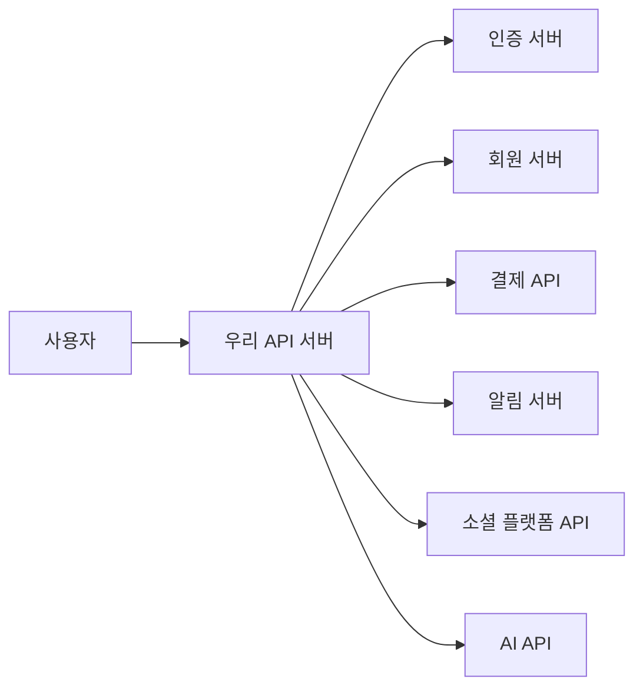
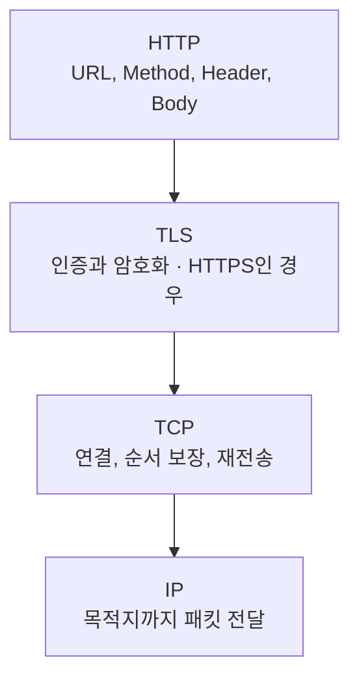
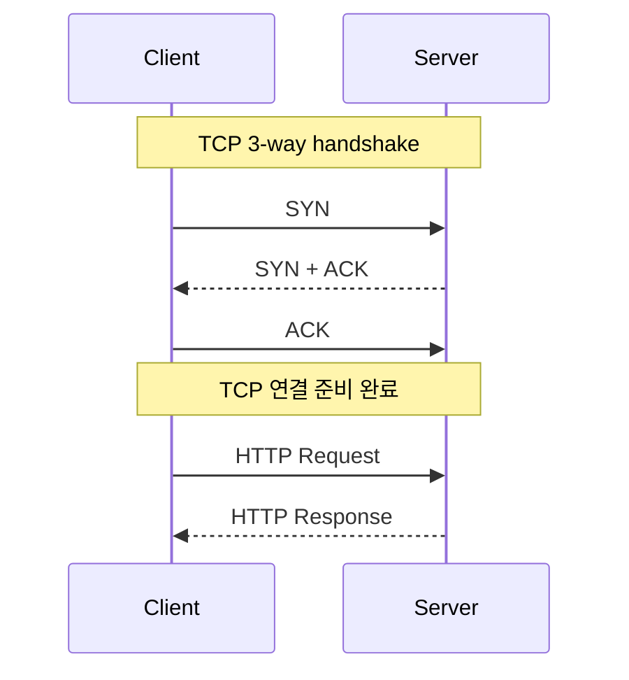
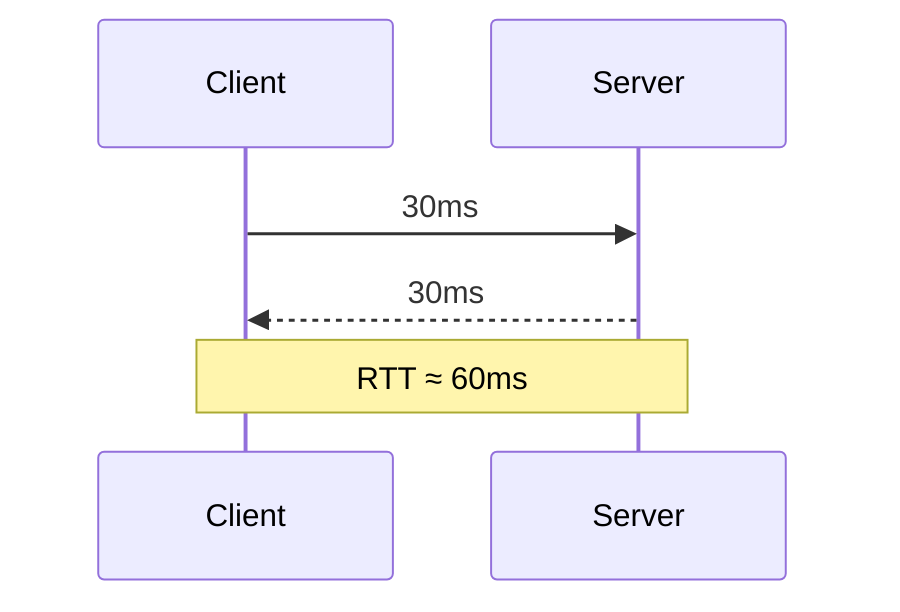
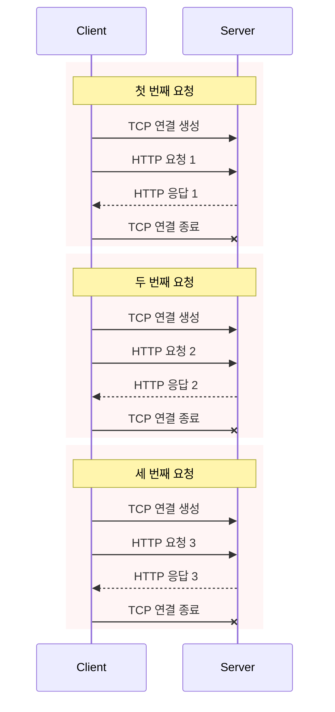
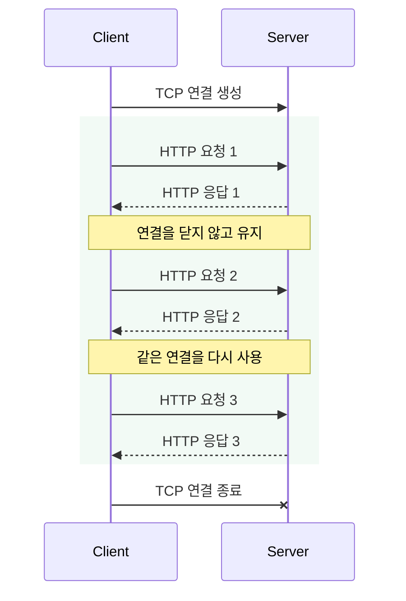
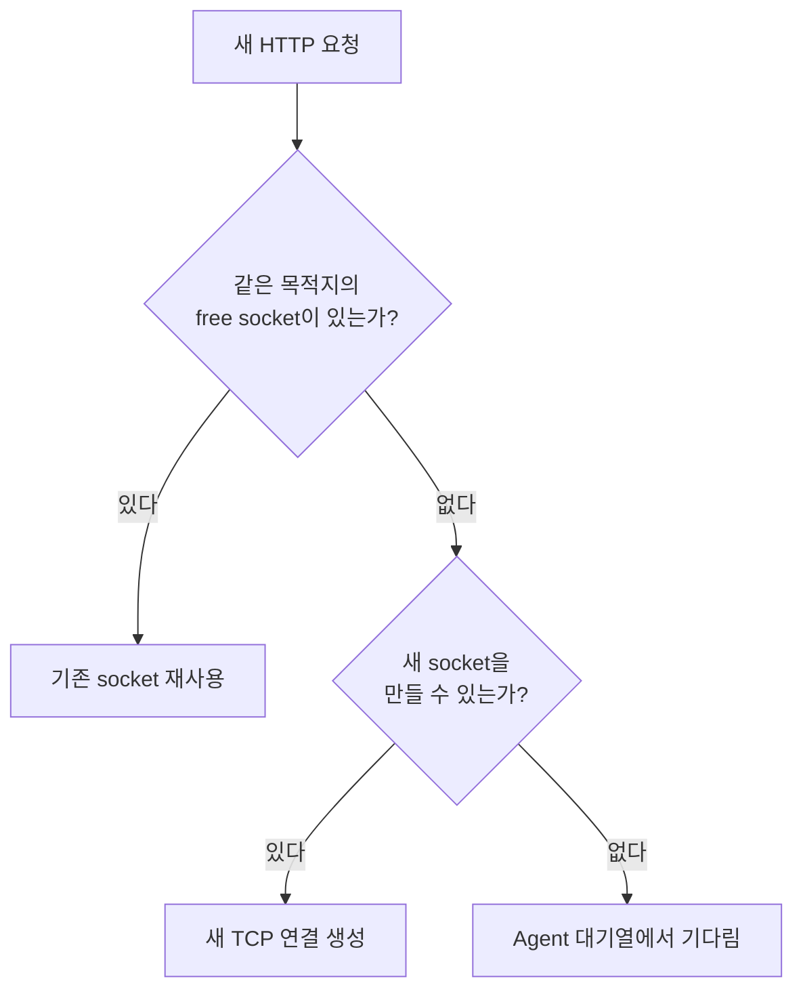
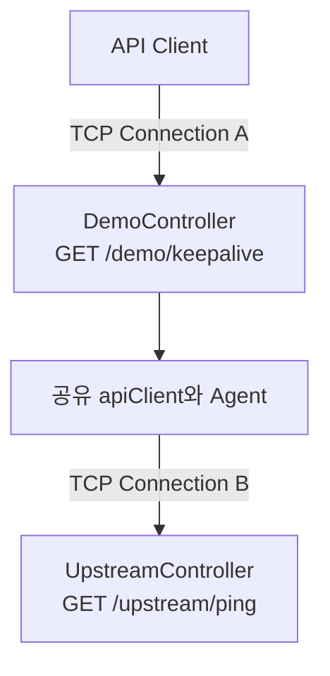
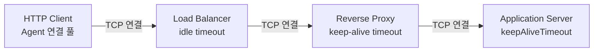
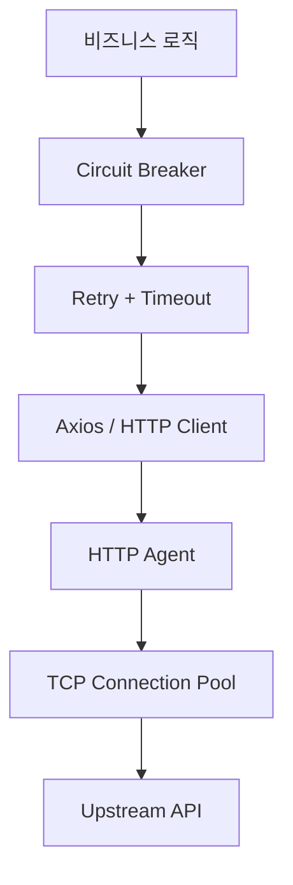

안녕하세요. 최근 NestJS 서버에서 외부 API 호출 구조를 살펴보면서 HTTP Keep-Alive를 공부하게 되었어요.

처음에는 Keep-Alive를 단순히 “연결을 오래 유지하는 옵션” 정도로 생각했어요. 하지만 실제 서버 구조를 떠올려 보면 Keep-Alive는 단순한 미세 최적화가 아니에요. 우리가 만드는 서버는 보통 혼자 동작하지 않거든요.



사용자 요청 하나를 처리하면서 여러 서버에 HTTP 요청을 보낼 수도 있어요. 이때 요청마다 TCP 연결을 새로 만든다면 실제 비즈니스 로직과 관계없는 연결 비용이 계속 쌓일 수 있어요.

이번 글에서는 TCP 연결부터 시작해 HTTP Keep-Alive가 왜 필요한지 알아볼게요. 그런 다음 NestJS와 Axios로 직접 실행할 수 있는 작은 예제를 만들고, 코드가 어떤 결과를 만드는지 순서대로 확인해 보려고 해요.

## HTTP 요청을 보내기 전에 일어나는 일

HTTP/1.1 요청은 일반적으로 TCP 연결 위에서 전달돼요. 클라이언트가 서버에 HTTP 요청을 보내려면 먼저 둘 사이에 TCP 연결이 만들어져야 하죠.



HTTP는 어떤 URL에 어떤 메서드와 데이터를 보낼지 정의하고, TCP는 그 HTTP 메시지가 이동할 수 있는 안정적인 통신 경로를 만들어요. 전화 통화로 비유하면 IP 주소는 회사 건물의 주소, Port는 내선번호, TCP 연결은 실제 전화 연결, HTTP 요청은 전화가 연결된 뒤 나누는 대화에 가까워요.

TCP는 연결을 만들 때 3-way handshake를 수행해요.



클라이언트가 연결을 요청하는 `SYN`을 보내고, 서버가 `SYN + ACK`로 응답한 뒤, 클라이언트가 다시 `ACK`를 보내면 비로소 데이터를 주고받을 준비가 끝나요.

이 과정에는 네트워크 왕복이 필요해요. HTTPS라면 TCP 연결 뒤에 TLS handshake도 추가되기 때문에 연결을 준비하는 비용은 더 커지고요. API 요청을 한 번만 보낼 때는 크게 느껴지지 않을 수 있지만, 서버 사이에서 짧은 요청이 계속 발생한다면 이야기가 달라져요.

## Round Trip은 무엇일까요?

네트워크를 공부하다 보면 **Round Trip** 또는 **RTT(Round-Trip Time)**라는 표현을 자주 만나게 돼요. 데이터가 클라이언트에서 서버로 갔다가 다시 클라이언트로 돌아오는 왕복과 그 시간을 뜻해요.



새 TCP 연결에서 첫 HTTP 요청을 보낼 때 드는 비용을 단순화하면 다음과 같아요.

```text
TCP 연결을 만들기 위한 왕복
+ HTTP 요청과 응답을 위한 왕복
+ 서버의 실제 처리 시간
```

HTTPS라면 서버 인증과 암호화 정보를 교환하는 TLS handshake도 필요해요. 반대로 기존 TCP 연결을 재사용하면 TCP 연결을 만드는 단계는 건너뛸 수 있어요.

Keep-Alive가 HTTP 요청 자체의 왕복이나 서버의 처리 시간을 없애주는 것은 아니에요. **같은 서버에 요청할 때마다 TCP 연결을 다시 만드는 비용**을 줄여주는 기능이에요.

## 요청마다 연결을 새로 만든다면?

한 서버가 같은 외부 API를 세 번 호출한다고 가정해 볼게요. 각 요청이 독립된 TCP 연결을 사용한다면 아래와 같은 흐름이 반복돼요.



HTTP 요청 자체는 금방 처리되더라도, 매번 TCP handshake를 기다려야 해요. 연결을 만들고 닫는 과정에서 클라이언트와 서버의 CPU도 사용하고, 짧은 연결이 한꺼번에 늘어나면 소켓과 포트 같은 운영체제 자원에도 부담을 줄 수 있어요.

예를 들어 주문 상세 API가 회원, 주문, 결제 서버를 각각 호출한다면 사용자 요청 하나가 여러 TCP 연결 생성으로 이어질 수 있어요. 트래픽이 갑자기 늘거나 새 서버 인스턴스들이 빈 연결 풀에서 동시에 시작하면 새 연결 생성도 한꺼번에 증가할 수 있고요. 이런 현상을 흔히 connection storm이라고 불러요.

그렇다면 이미 만든 연결을 다음 요청에서도 사용할 수는 없을까요?

## HTTP Keep-Alive로 연결 재사용하기

HTTP Keep-Alive는 하나의 HTTP 요청과 응답이 끝난 뒤에도 TCP 연결을 바로 닫지 않고, 다음 요청에서 다시 사용하는 방식이에요.



이제 TCP 연결은 처음에 한 번만 만들면 돼요. 두 번째 요청부터는 이미 준비된 연결을 가져와 바로 데이터를 보낼 수 있죠. 같은 서버로 요청을 자주 보내는 서비스일수록 이 차이가 쌓여 응답 지연과 연결 생성 비용을 줄이는 데 도움이 돼요.

여기서 한 가지 주의할 점이 있어요. HTTP/1.1은 지속 연결을 기본으로 사용하지만, 애플리케이션에서 실제로 연결이 재사용되려면 클라이언트가 사용 가능한 소켓을 보관하고 관리해야 해요. Node.js에서는 이 역할을 `http.Agent`와 `https.Agent`가 담당해요.

## Keep-Alive는 연결 하나만 사용하는 기능이 아니에요

Keep-Alive를 처음 접하면 모든 요청을 TCP 연결 하나로 처리한다고 생각하기 쉬워요. 하지만 정확한 의미는 **필요한 만큼 연결을 만들되, 사용이 끝난 연결을 바로 버리지 않고 이후 요청에서 재사용하는 것**이에요.

요청을 하나씩 순차 실행하면 연결 하나로 충분할 수 있어요.

```ts
await api.get('/users');
await api.get('/posts');
await api.get('/comments');
```

```text
/users    → TCP #1 생성
/posts    → TCP #1 재사용
/comments → TCP #1 재사용
```

반면 세 요청을 동시에 실행하면 첫 번째 소켓이 사용 중인 동안 다른 요청을 처리할 소켓이 더 필요할 수 있어요.

```ts
await Promise.all([
  api.get('/users'),
  api.get('/posts'),
  api.get('/comments'),
]);
```

```text
/users    → TCP #1
/posts    → TCP #2
/comments → TCP #3
```

요청이 끝난 뒤 TCP #1, #2, #3은 다음 요청에서 다시 쓸 수 있는 free socket이 돼요. Keep-Alive는 “연결 하나만 사용하기”가 아니라 “만들어진 연결을 버리지 않고 풀에서 재사용하기”에 가까워요.

## HTTP Keep-Alive와 TCP Keepalive는 달라요

이름이 비슷해서 자주 혼동되는 개념도 있어요.

- **HTTP Keep-Alive**는 여러 HTTP 요청이 하나의 TCP 연결을 재사용하도록 해요.
- **TCP Keepalive**는 오랫동안 데이터가 오가지 않는 TCP 연결이 아직 살아 있는지 운영체제 수준에서 확인해요.

즉, HTTP Keep-Alive의 관심사는 **연결 재사용**이고 TCP Keepalive의 관심사는 **죽은 연결 감지**예요. Node.js Agent의 `keepAlive: true`는 소켓을 재사용할 수 있도록 관리하며, `keepAliveMsecs`는 TCP keepalive probe를 시작할 때 사용하는 초기 지연값이에요. 이름만 보고 `keepAliveMsecs`를 “소켓을 풀에 30초 동안 보관하는 설정”으로 이해하면 안 돼요.

## Node.js에서 연결 풀 만들기

Node.js에서는 `http.Agent`와 `https.Agent`가 소켓을 관리해요. 쉽게 말하면 Agent는 TCP connection pool 관리자예요.



Agent 내부에는 현재 요청에 사용 중인 active socket, 요청을 마치고 기다리는 free socket, 소켓을 기다리는 pending request가 있어요. 이제 HTTP와 HTTPS 요청에 사용할 Agent를 한 번 만들어 재사용해 볼게요.

```ts
import http from 'node:http';
import https from 'node:https';

export const httpAgent = new http.Agent({
  keepAlive: true,
  keepAliveMsecs: 30_000,
  maxSockets: 128,
  maxFreeSockets: 32,
});

export const httpsAgent = new https.Agent({
  keepAlive: true,
  keepAliveMsecs: 30_000,
  maxSockets: 128,
  maxFreeSockets: 32,
});
```

각 설정의 역할은 다음과 같아요.

- `keepAlive`: 요청이 끝난 소켓을 바로 없애지 않고 다음 요청에서 재사용해요.
- `keepAliveMsecs`: 유휴 소켓에 TCP keepalive probe를 시작할 초기 지연값을 지정해요.
- `maxSockets`: 대상 호스트 하나에 동시에 열 수 있는 소켓 수를 제한해요.
- `maxFreeSockets`: 요청을 처리하지 않고 풀에서 기다릴 수 있는 유휴 소켓 수를 제한해요.

`maxSockets`를 무조건 크게 잡는 것이 좋은 것은 아니에요. 값이 너무 크면 순간적으로 많은 연결이 만들어져 상대 서버에 부담을 줄 수 있고, 너무 작으면 요청이 소켓을 기다리며 대기할 수 있어요. 트래픽과 상대 서버의 처리 용량을 함께 보고 정해야 해요.

## Axios가 같은 Agent를 사용하게 만들기

Agent를 만들기만 해서는 충분하지 않아요. Axios 인스턴스에 Agent를 연결하고, 이 인스턴스를 애플리케이션에서 계속 공유해야 해요.

```ts
import axios from 'axios';
import { httpAgent, httpsAgent } from './agents';

export const apiClient = axios.create({
  baseURL: 'http://localhost:3000',
  timeout: 3_000,
  httpAgent,
  httpsAgent,
});
```

HTTP 요청에는 `httpAgent`, HTTPS 요청에는 `httpsAgent`가 사용돼요. 여기서 중요한 점은 요청마다 Agent나 Axios 인스턴스를 새로 만들지 않는 거예요. 위 코드처럼 모듈의 최상위에서 한 번 만든 `apiClient`를 공유해야 이전 요청이 남긴 소켓을 다음 요청에서 사용할 수 있어요.

여기서 `keepAliveMsecs`의 단위는 밀리초이므로 `30_000`은 30초예요. 다만 이 값은 HTTP 연결을 풀에 30초 동안 보관한다는 뜻이 아니라 TCP keepalive probe의 초기 지연값이에요.

Axios의 `timeout: 3_000`도 연결의 수명이 아니에요. 현재 진행 중인 HTTP 요청을 최대 3초 기다린다는 뜻이에요. 요청이 끝난 뒤 free socket이 얼마나 살아 있을지는 Agent, 서버, 중간 네트워크 장비의 별도 생명주기에 따라 결정돼요.

또한 Agent는 목적지별로 소켓 풀을 구분해요. 단순화하면 프로토콜, 호스트, 포트가 달라지면 서로 다른 연결을 사용해요.

```text
http://localhost:3000
http://localhost:3001
https://localhost:3000
https://api.example.com:443
```

결제 API에 연결한 소켓을 소셜 플랫폼 API 요청에 재사용할 수는 없어요.

## 정말 같은 소켓을 사용할까?

이제 연결이 실제로 재사용되는지 확인할 차례예요. 먼저 호출을 받을 upstream 역할의 간단한 API를 만들게요.

```ts
@Controller('upstream')
export class UpstreamController {
  @Get('ping')
  ping() {
    return { ok: true, at: new Date().toISOString() };
  }
}
```

다음으로 테스트를 시작할 `/demo/keepalive` API를 만들어요. 이 API는 앞에서 만든 공유 `apiClient`로 `/upstream/ping`을 순차적으로 다섯 번 호출해요. 각 요청이 끝나면 Node.js의 `reusedSocket` 값을 읽어 기존 소켓을 사용했는지 기록하고요.

```ts
@Controller('demo')
export class DemoController {
  @Get('keepalive')
  async keepalive(@Query('count') count = '5') {
    const results = [];

    for (let i = 0; i < Number(count); i++) {
      const start = Date.now();
      const response = await apiClient.get('/upstream/ping');

      results.push({
        i: i + 1,
        ms: Date.now() - start,
        reusedSocket: Boolean(response.request.reusedSocket),
      });
    }

    return results;
  }
}
```

마지막으로 두 Controller를 애플리케이션 모듈에 등록해요.

```ts
@Module({
  controllers: [DemoController, UpstreamController],
})
export class AppModule {}
```

이제 서버를 실행하면 준비가 끝나요. 예제를 간단하게 유지하기 위해 upstream도 같은 프로세스에 두었지만, Axios는 `localhost:3000`으로 실제 HTTP 요청을 보내요.

이 예제의 연결 구조를 정확히 보면 TCP 연결이 두 개 있어요.



두 Controller가 같은 NestJS 프로세스에 있어도 운영체제의 TCP 소켓을 사용해요. 로그의 `reusedSocket`은 API Client가 만든 Connection A가 아니라, 내부 Axios 요청에 사용된 Connection B의 재사용 여부예요.

서버를 실행한 뒤 다른 터미널에서 API를 호출하면 돼요.

```bash
pnpm start
```

```bash
curl 'http://localhost:3000/demo/keepalive?count=5'
```

이제 응답을 확인해 볼게요. 실행 환경에 따라 시간은 달라질 수 있지만, 한 번 실행했을 때는 아래와 같은 결과가 나왔어요.

```json
[
  { "i": 1, "ms": 10, "reusedSocket": false },
  { "i": 2, "ms": 1, "reusedSocket": true },
  { "i": 3, "ms": 1, "reusedSocket": true },
  { "i": 4, "ms": 0, "reusedSocket": true },
  { "i": 5, "ms": 1, "reusedSocket": true }
]
```

처음 요청이 시작될 때는 Agent에 `localhost:3000`으로 연결된 소켓이 없어요. 그래서 새 TCP 연결을 만들고 `reusedSocket=false`가 돼요. Keep-Alive가 활성화됐다는 것은 첫 요청 전부터 연결이 미리 존재한다는 뜻이 아니라, **첫 요청에서 만든 연결을 다음 요청을 위해 남겨둔다는 뜻**이에요.

첫 응답이 끝나면 소켓은 Agent의 free socket 풀로 돌아가요. 두 번째 요청은 같은 목적지의 소켓을 찾아 TCP handshake 없이 HTTP 요청을 전송할 수 있어요. 그래서 이후 요청의 `reusedSocket`은 `true`가 돼요.

```text
#1 → TCP #1 생성   → false
#2 → TCP #1 재사용 → true
#3 → TCP #1 재사용 → true
#4 → TCP #1 재사용 → true
#5 → TCP #1 재사용 → true
```

다만 `10ms - 1ms = 9ms`를 TCP handshake 시간이라고 해석하면 안 돼요. 측정값에는 소켓 생성뿐 아니라 Axios 요청 생성, 운영체제 scheduling, Node.js 이벤트 루프, NestJS 라우팅, JSON 직렬화와 파싱 같은 과정이 모두 포함돼요. 첫 실행의 초기화나 런타임 warm-up도 영향을 줄 수 있고요.

응답 시간은 실행 환경에 따라 달라지므로 숫자 자체보다 `reusedSocket`의 변화를 보는 것이 중요해요. 성능을 비교하려면 충분히 반복한 뒤 평균과 함께 p95, p99도 살펴봐야 해요.

같은 `/demo/keepalive` API를 바로 다시 호출하면 두 번째 실행의 첫 내부 요청부터 `true`가 나올 수도 있어요. Controller의 반복문에서는 첫 번째 요청이지만, 애플리케이션에서 공유되는 Agent의 관점에서는 이미 기존 요청이 남긴 free socket이 있기 때문이에요. 물론 서버가 유휴 연결을 닫았거나 프로세스가 재시작됐다면 다시 `false`가 될 수 있어요.

## 클라이언트만 설정하면 끝일까?

Keep-Alive는 클라이언트와 서버가 함께 연결을 유지할 수 있어야 제대로 동작해요. 클라이언트의 풀에 소켓이 남아 있더라도 서버가 먼저 연결을 닫았다면 그대로 재사용할 수 없어요.

실제 요청은 애플리케이션 서버까지 곧바로 도착하지 않고 여러 계층을 통과하는 경우가 많아요.



각 구간은 서로 다른 TCP 연결과 타임아웃을 가질 수 있어요. 그래서 어느 한 곳에서 연결을 먼저 닫으면 다른 계층의 연결 재사용에도 영향을 줄 수 있죠.

예제 서버에는 아래와 같이 요청과 연결에 관한 타임아웃을 설정할 수 있어요.

```ts
const httpServer = app.getHttpServer() as Server;

httpServer.keepAliveTimeout = 65_000;
httpServer.headersTimeout = 66_000;
httpServer.requestTimeout = 30_000;
```

- `keepAliveTimeout`: 응답을 마친 뒤 다음 요청을 기다리며 유휴 연결을 유지하는 시간이에요.
- `headersTimeout`: 요청 헤더 전체가 도착하기까지 기다리는 시간이에요.
- `requestTimeout`: 요청 전체를 받기까지 기다리는 시간이에요.

여기서는 `headersTimeout`을 `keepAliveTimeout`보다 조금 크게 설정했어요. 실제 운영 환경에서는 애플리케이션 서버만 볼 것이 아니라 로드 밸런서, 프록시, API Gateway의 idle timeout도 함께 확인해야 해요. 중간 장비가 더 일찍 연결을 끊을 수 있기 때문이에요.

## 운영 환경에서 함께 생각할 것들

HTTP Keep-Alive를 켜는 것만으로 모든 문제가 해결되지는 않아요. 연결을 오래 재사용하는 만큼 풀의 크기와 타임아웃을 서비스 상황에 맞게 관리해야 해요.

### 1. 연결 수에 상한을 두기

트래픽이 갑자기 늘었을 때 연결도 끝없이 늘어나면 상대 서버와 우리 서버 모두 부담을 받아요. `maxSockets`로 동시 연결 수를 제한하고, 대기 시간이 길어지는지도 함께 관찰하는 것이 좋아요.

### 2. 유휴 소켓을 지나치게 많이 남기지 않기

다시 쓸 가능성이 낮은 연결까지 풀에 많이 보관하면 파일 디스크립터와 메모리를 차지해요. `maxFreeSockets`를 조정해 필요한 만큼만 유지해야 해요.

### 3. 타임아웃의 순서를 맞추기

클라이언트, 서버, 로드 밸런서가 서로 다른 타임아웃을 가지고 있으면 한쪽은 살아 있다고 생각한 연결을 다른 쪽은 이미 닫은 상황이 생길 수 있어요. 각 계층의 타임아웃을 확인하고 의도한 순서로 연결이 정리되도록 설계해야 해요.

### 4. 재시도와는 별개의 문제로 보기

Keep-Alive는 연결 생성 비용을 줄이는 기능이지, 실패한 요청을 성공으로 바꾸는 기능은 아니에요. 이미 닫힌 소켓을 재사용하는 과정에서 오류가 발생할 수도 있어요. 재시도가 필요하다면 요청의 멱등성, 재시도 횟수, 지수 백오프를 따로 고려해야 해요.

### 5. 지표로 효과 확인하기

평균 응답 시간만 보면 연결 재사용의 효과나 문제를 놓치기 쉬워요. 가능하다면 소켓 생성 수, 현재 사용 중인 소켓과 유휴 소켓 수, 연결 오류, p95·p99 지연 시간을 함께 살펴보는 것이 좋아요.

| 관찰할 값 | 확인하려는 문제 |
| --- | --- |
| 요청 p50, p95, p99 | 연결 재사용 후 지연이 개선됐는지 |
| 새 소켓 생성 수 | 연결이 지나치게 자주 만들어지는지 |
| active socket 수 | upstream으로 동시 연결이 얼마나 열리는지 |
| free socket 수 | 유휴 연결을 너무 많이 보관하는지 |
| pending request 수 | `maxSockets` 때문에 요청이 대기하는지 |
| `ECONNRESET` 수 | 클라이언트와 서버의 연결 생명주기가 충돌하는지 |
| reused socket 비율 | 실제로 연결이 재사용되는지 |

Node.js Agent는 사용 중인 소켓, free socket, 대기 중인 요청을 각각 `agent.sockets`, `agent.freeSockets`, `agent.requests`로 노출해요. 애플리케이션에서 직접 수정하지 않고 관찰용 지표로 활용할 수 있어요.

## HTTP Client는 upstream별로 나누기

모든 외부 API가 같은 특성을 가지지는 않아요. 결제 API는 실패에 민감하고, 분석 API는 요청량이 많으며, AI API는 한 요청이 오래 걸릴 수 있어요. 그래서 하나의 거대한 전역 클라이언트보다 upstream별 클라이언트를 구성하는 편이 관리하기 좋아요.

```text
PaymentHttpClient
→ 짧은 timeout, 작은 maxSockets, 보수적인 retry

AnalyticsHttpClient
→ 큰 처리량, 비교적 큰 maxSockets

AiHttpClient
→ 긴 timeout, 엄격한 동시 요청 제한
```

이렇게 나누면 분석 API의 요청 폭증이 결제 API의 연결 풀까지 차지하는 일을 막을 수 있어요. 서버 인스턴스 수도 함께 계산해야 해요. 예를 들어 인스턴스가 20개이고 각 인스턴스의 `maxSockets`가 128이라면, 한 upstream에 이론상 최대 2,560개의 active connection이 만들어질 수 있어요.

Worker에서도 같은 원칙이 적용돼요. 작업마다 Agent를 새로 만들면 `keepAlive: true`여도 이전 작업의 소켓을 재사용할 수 없어요.

```ts
// 애플리케이션 시작 시 한 번 생성해 공유해요.
const httpsAgent = new HttpsAgent({
  keepAlive: true,
  maxSockets: 20,
  maxFreeSockets: 5,
});

const paymentClient = axios.create({
  baseURL: 'https://payments.example.com',
  timeout: 3_000,
  httpsAgent,
});

async function processJob(paymentId: string) {
  return paymentClient.get(`/payments/${paymentId}`);
}
```

기존 프로젝트가 Axios 중심이라면 지금처럼 Axios와 custom Agent를 공유하는 방식이 자연스러워요. NestJS의 공식 Axios 모듈을 사용한다면 DI로 서비스별 클라이언트를 제공할 수도 있고, 새로운 Node.js 프로젝트라면 Undici의 `Pool`이나 `Agent`도 선택지가 될 수 있어요. 어떤 도구를 고르든 핵심은 클라이언트의 생명주기와 연결 풀의 경계를 명확히 하는 거예요.

## Keep-Alive만으로 운영 환경이 완성되지는 않아요

Keep-Alive는 정상적인 연결을 효율적으로 재사용해요. 하지만 느린 upstream, 일시적인 네트워크 오류, 지속적인 장애, 배포 중인 서버의 연결 정리까지 해결해 주지는 않아요.



예제를 운영 환경에 가깝게 확장한다면 `axios-retry`, `opossum`, `lil-http-terminator` 같은 도구를 함께 검토할 수 있어요. 이 글의 Keep-Alive 코드에는 적용하지 않았지만, 각 도구의 역할은 다음처럼 구분할 수 있어요.

- `axios-retry`: 네트워크 오류처럼 잠깐 실패한 요청을 정해진 조건으로 다시 시도해요.
- `opossum`: 실패가 계속되는 upstream 호출을 잠시 차단하는 Circuit Breaker를 만들 수 있어요.
- `lil-http-terminator`: 서버 종료 시 새 요청을 막고 처리 중인 요청과 연결을 정리하는 graceful shutdown을 도와줘요.

재시도는 특히 조심해야 해요. 결제나 주문 생성 요청은 서버에서 처리됐지만 응답만 유실됐을 수 있어요. 쓰기 요청을 재시도하려면 `Idempotency-Key`, 중복 요청 식별자, 데이터베이스 unique constraint처럼 중복 처리를 막는 장치가 필요해요.

```text
Keep-Alive → 연결 재사용
Timeout    → 너무 느린 요청 제한
Retry      → 일시적인 오류 복구
Circuit Breaker → 지속적으로 실패하는 upstream 보호
Graceful Shutdown → 배포 시 연결을 안전하게 정리
```

## 마치며

처음에는 HTTP 요청 한 번을 보내는 코드가 단순해 보여요.

```ts
await axios.get('/users');
```

하지만 이 한 줄 아래에서는 TCP 연결을 만들고, 데이터를 주고받고, 연결을 정리하는 일이 일어나요. 요청마다 이 과정을 반복하면 불필요한 네트워크 왕복과 시스템 비용이 쌓일 수 있어요.

HTTP Keep-Alive와 연결 풀을 사용하면 이미 만든 TCP 연결을 여러 HTTP 요청이 나누어 쓸 수 있어요. Node.js에서는 공유되는 `http.Agent`와 `https.Agent`를 만들고, Axios 인스턴스에 주입해 이 구조를 구현할 수 있고요.

이번 글의 핵심을 정리하면 다음과 같아요.

- HTTP/1.1 요청은 일반적으로 TCP 연결 위에서 전달돼요.
- 새 TCP 연결에는 handshake 비용이 들어요. HTTPS라면 TLS 연결 비용도 추가돼요.
- HTTP Keep-Alive는 요청이 끝난 TCP 연결을 풀에 보관했다가 다음 요청에서 재사용해요.
- HTTP Keep-Alive와 TCP Keepalive는 서로 다른 문제를 해결해요.
- Keep-Alive는 연결 하나만 고집하는 것이 아니라, 필요한 연결을 만들고 재사용하는 방식이에요.
- Agent는 요청마다 만들지 않고 애플리케이션에서 공유해야 해요.
- 실제 실험에서는 시간 차이보다 `reusedSocket`이 연결 재사용의 더 직접적인 증거예요.
- 운영 환경에서는 연결 수, 유휴 소켓 수, 서버와 중간 장비의 타임아웃, 재시도와 종료 전략을 함께 설계해야 해요.

HTTP Keep-Alive의 핵심은 첫 번째 요청에서 만든 TCP 연결을 바로 버리지 않고 connection pool에 남겨두어, 같은 서버로 향하는 후속 요청이 연결 수립 과정을 건너뛰게 하는 것이에요.

하지만 연결을 무작정 많이, 오래 유지한다고 좋은 것은 아니에요. 필요한 연결은 만들고, 만들어진 연결은 재사용하고, 동시 연결 수는 제한하고, 사용하지 않는 연결은 정리해야 해요. 여기에 안전한 재시도와 Circuit Breaker, graceful shutdown까지 더해져야 운영 환경의 연결 생명주기가 완성돼요.

이 흐름을 이해하고 나면 Keep-Alive는 단순한 성능 옵션이 아니라, **TCP 연결이라는 유한한 자원을 효율적으로 관리하기 위한 연결 생명주기 전략**으로 보이기 시작할 거예요.
