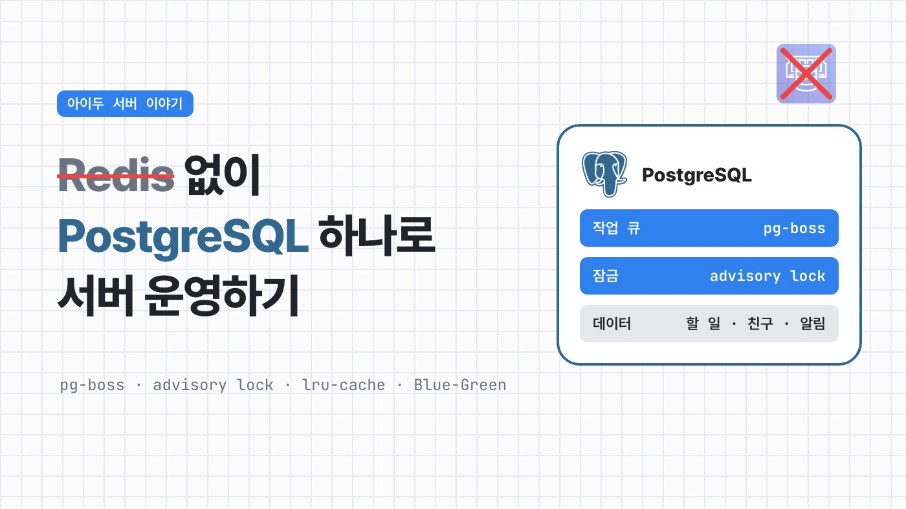

해외 강의 영상으로 공부하다 보면 PostgreSQL을 쓰는 경우가 정말 많았습니다. 그래서 아이두를 처음 만들 때도 자연스럽게 PostgreSQL을 골랐습니다. 다만 서버를 만드는 데 급급해서 왜 PostgreSQL이어야 하는지는 따져 보지 못했고 테이블을 만들고 조인하는 정도로만 썼습니다. 사실상 일반적인 DB들과 별반 다르지 않게 쓰고 있었습니다.

그러다 배포로 서버가 잠깐 내려가는 사이에 돈을 낸 프리미엄 고객에게 주간·월간 AI 리포트가 제대로 전달되지 않는 일을 겪었습니다. 급한 대로 Redis를 붙여서 막았습니다.

생각이 바뀐 건 [모여](https://moyeo.io)를 혼자 바닥부터 만들면서였습니다. 예약 발행 큐의 예외 상황을 다루다가 pg-boss와 `pg_notify`를 알게 됐고 써 보니 인프라 비용을 늘리지 않고도 충분히 풀 수 있는 문제였습니다. 그래서 아이두에도 바로 적용했습니다.

부트캠프나 교육에서 배우는 정답은 당연히 좋은 답입니다. 다만 그 답이 지금 내가 처한 상황에서도 가장 알맞은 답인지는 또 다른 문제라고 생각합니다. 교육은 문제를 푸는 방법을 알려 주지만 내 서비스의 규모와 예산, 혼자 운영할 수 있는 범위까지 대신 따져 주지는 못합니다. 그건 그 상황에 직접 서 봐야 보입니다. 문제를 푸는 방법으로는 맞아도 내 상황에 맞는 방법은 아닐 수 있습니다. 아이두도 그랬습니다. 처음 Redis를 붙여 문제를 푼 방식도 정답이었지만 조금 더 깊게 들여다보니 더 나은 답이 있었습니다. 물론 지금 고른 답에도 더 나은 답이 있을 수 있습니다.

밑바닥부터 서비스를 키우다 보면 그 순간에 정말 필요한 것이 하나씩 보입니다. 인프라 비용도 그렇습니다. 사이드 프로젝트에서는 비용이 내 돈으로 나가니 아낄 길이 더 잘 보였고 이번에 아낀 돈은 **매달 치킨 한 마리 값**입니다.

이 글은 아이두 서버에서 Redis를 걷어 내고 PostgreSQL 하나로 작업 큐와 잠금, 무중단 배포까지 옮긴 과정을 정리한 기록입니다. 작은 프로젝트에 습관처럼 Redis부터 붙이려는 분이 있다면 이 삽질을 보고 다른 선택지를 한 번쯤 떠올려 보시면 좋겠습니다.

---

## 배포할 때마다 사라지던 작업

아이두에서 친구의 할 일에 응원을 보내면 친구에게 푸시 알림이 갑니다. 할 일에 시간을 정해 두면 그 시간에 리마인더가 울립니다. 처음에는 이런 "나중에 해야 할 일"을 서버 메모리에 들고 있었습니다. 알림은 EventEmitter로 서버 안에서 넘겨 보냈고 리마인더는 `setTimeout`으로 예약했습니다.

개발할 때는 아무 문제가 없었습니다. 문제는 배포였습니다.

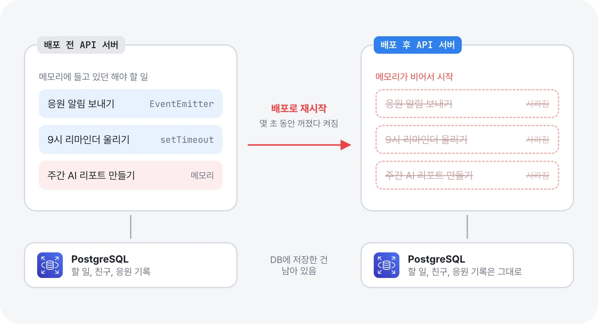

새 버전을 배포하면 서버는 몇 초 동안 꺼졌다가 다시 켜집니다. 이 몇 초 사이에 두 가지 일이 함께 벌어졌습니다.

하나는 메모리에 들고 있던 "해야 할 일"이 그 순간 모두 사라진다는 점입니다. DB에 저장한 할 일은 그대로지만 응원 알림이 오지 않거나 리마인더가 울리지 않았습니다. 그나마 이건 나은 편이었고 프리미엄 고객이 돈을 내고 받아 보는 주간·월간 AI 리포트가 만들어지지 않는 일까지 생겼습니다.

다른 하나는 서버가 꺼져 있는 동안 앱을 쓰던 사용자가 오류를 본다는 점입니다. 그 사이에 할 일을 저장하거나 완료한 요청은 받아 줄 서버가 없어서 실패했습니다.

그래서 풀어야 할 숙제는 두 가지였습니다. **서버가 꺼져도 해야 할 일은 어딘가에 기록돼 있어야 하고 서버가 바뀌는 순간에도 사용자는 장애를 겪지 않아야 했습니다.** 첫 번째는 작업 큐로, 두 번째는 Blue-Green 배포로 풀었습니다. 작업 큐 이야기부터 하겠습니다.

---

## 처음 고른 답, Redis

가장 먼저 떠오른 건 Redis였습니다. Redis는 서버 밖에 따로 떠 있는 저장소라서 API 서버가 다시 켜져도 데이터가 남습니다. 여기에 BullMQ라는 작업 큐 라이브러리를 얹으면 "나중에 할 일"을 Redis에 넣어 두고 서버가 다시 켜진 뒤 꺼내 쓸 수 있습니다.

그래서 EC2 한 대와 RDS의 PostgreSQL로 돌던 서버에 AWS ElastiCache로 Redis를 하나 더 붙였습니다. 이왕 붙인 김에 캐시와 요청 횟수 제한, 분산 잠금까지 Redis에 맡겼습니다.

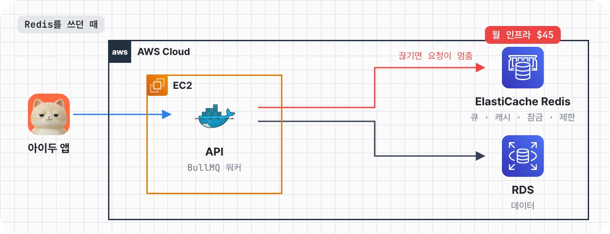

효과는 있었습니다. 배포해도 작업이 남았고 알림도 다시 나갔습니다. 대신 두 가지 대가가 따라왔습니다.

하나는 비용입니다. ElastiCache 노드가 붙으면서 월 인프라 비용이 $45까지 올라갔습니다. 엔진을 Valkey로 바꾸면 조금 줄일 수 있지만 외부 캐시 비용이 나간다는 점은 같습니다.

다른 하나는 Redis가 새로운 약점이 됐다는 점입니다. 캐시를 읽는 코드도, 요청 제한도, 잠금도 전부 Redis 응답을 기다리고 있어서 Redis 연결이 끊기면 **모든 API 요청이 응답 없이 멈췄습니다.** 알림을 지키려고 붙인 부품이 오히려 서버 전체를 멈출 수 있는 부품이 됐습니다.

그래서 Redis의 장애가 서비스 전체의 장애로 번지지 않게 하는 구현이 따로 필요했습니다. Redis 응답이 늦으면 오래 기다리지 않고 바로 실패하게 하고 캐시를 읽지 못하면 DB에서 다시 읽게 했습니다. 문제를 막으려고 들인 부품을 지키는 코드가 또 늘어난 겁니다.

---

## 질문을 다시 세우다

돌아보면 문제를 "해야 할 일을 서버 밖 어딘가에 남겨야 한다"로만 보고 있었습니다. 그러니 답도 "서버 밖의 저장소를 하나 더 붙인다"밖에 없었습니다.

모여에서 예약 큐를 다루며 배운 걸 아이두에 비춰 보니 질문이 바뀌었습니다. 할 일을 완료하면 서버는 두 가지를 씁니다. "이 할 일이 완료됐다"는 기록과 "친구에게 알림을 보내라"는 작업입니다. 진짜 문제는 이 두 가지가 함께 남느냐였습니다.

DB는 여러 번의 쓰기를 하나로 묶어서 전부 저장하거나 하나도 저장하지 않게 해 줍니다. 이 묶음이 트랜잭션이고 저장이 확정되는 순간을 커밋이라고 부릅니다. 할 일은 PostgreSQL에 쓰고 알림 작업은 Redis에 쓰면 이 둘은 한 트랜잭션으로 묶이지 않습니다. 두 쓰기 사이에 서버가 꺼지면 한쪽만 남습니다.

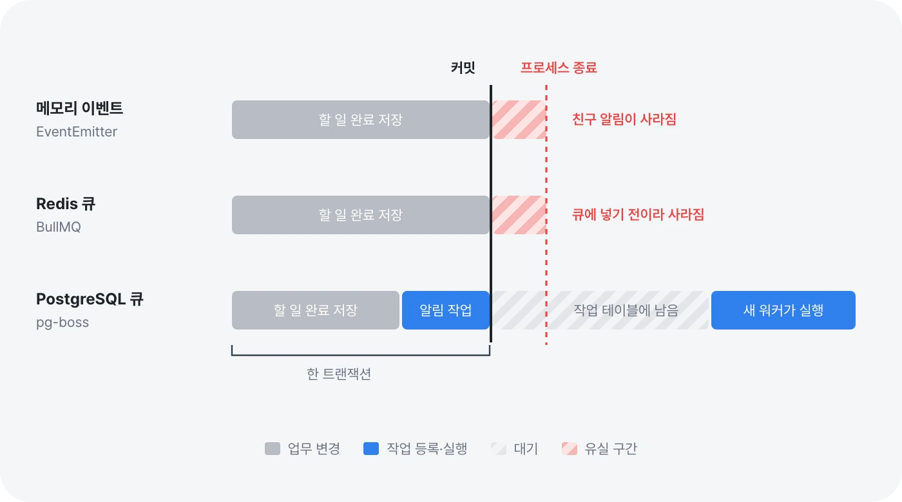

이미 PostgreSQL을 쓰고 있으니 알림 작업도 할 일과 같은 DB의 같은 트랜잭션에 넣으면 되지 않을까요?

---

## 작업 큐를 PostgreSQL 안으로

그 답이 [pg-boss](https://github.com/timgit/pg-boss)였습니다. pg-boss는 작업을 PostgreSQL 테이블에 저장하는 작업 큐입니다. 작업을 넣는 일도 같은 DB에 대한 `INSERT`라서 할 일을 저장하는 트랜잭션 안에서 함께 넣을 수 있습니다.

사용자가 할 일 하나를 완료했을 때 서버에서 무슨 일이 일어나는지 따라가 보겠습니다.

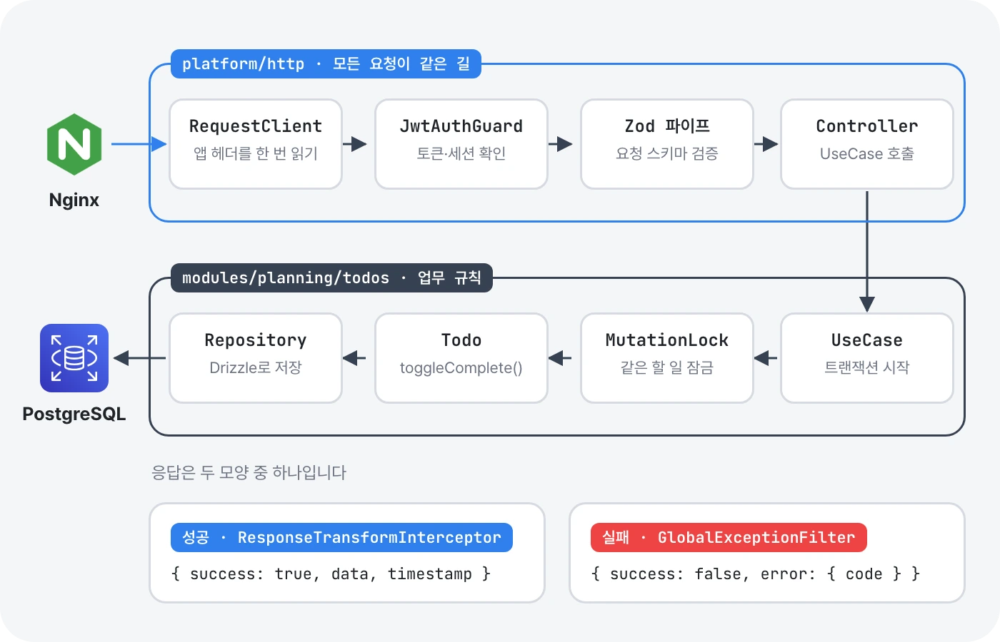

요청은 인증과 검증을 거쳐 할 일 완료 UseCase에 도착합니다. UseCase는 트랜잭션을 열고 그 안에서 모든 일을 처리합니다.

```ts title="할 일 완료 UseCase" {4,6,13-14}
const todoId = TodoId.reconstitute(id);

await unitOfWork.run(async () => {
  await mutationLock.acquire([TodoLockKeys.todo(id)]);
  const todo = await todoRepository.findByIdAndUserId(todoId, ownerId);
  const changed = todo.toggleComplete(completed, timezone, clock.now());
  if (!changed) {
    return;
  }

  await todoRepository.updateDetails(todoId, { completed: todo.completed, completedAt: todo.completedAt });
  const events = todo.pullDomainEvents();
  await applyTodoEvents.execute(events);
  await completionEffects.execute(events);
});
```

<p class="code-caption">set-todo-completed.use-case.ts 일부</p>

먼저 같은 할 일을 동시에 바꾸지 못하게 잠급니다. 완료 상태를 바꾼 뒤에는 그 결과로 생긴 후속 처리를 이어서 부릅니다. `toggleComplete()`는 값이 실제로 바뀐 경우에만 `true`를 돌려주니 같은 요청이 두 번 와도 알림은 한 번만 나갑니다. 후속 처리 중 `completionEffects`는 오늘 할 일을 다 끝냈으면 친구에게 보낼 알림 작업을 큐에 넣습니다.

```ts title="다 끝냈으면 친구 알림 작업 넣기" {6}
if (!isAllCompletedToday(todayStats)) {
  return;
}
const friendIds = await friendPort.getMutualFriendIds(ownerId);

await todoNotification.enqueueFriendCompleted({
  friendId: ownerId.value,
  notifyUserIds: friendIds,
  timezone,
});
```

<p class="code-caption">apply-todo-completion-effects.use-case.ts 일부</p>

이 작업은 pg-boss 어댑터를 거쳐 PostgreSQL에 들어갑니다. 핵심은 한 줄입니다.

```ts title="지금 열린 트랜잭션으로 작업 넣기" {4}
async enqueue(queue, payload, options = {}) {
  return this.#boss.send(queue.name, payload, {
    ...toPgBossJobOptions(queue, options),
    db: transactionJobDatabase(this.#txHost.tx),
  });
}
```

<p class="code-caption">pg-boss-job-queue.adapter.ts 일부</p>

`db` 옵션에 지금 열린 트랜잭션을 넘기니 할 일과 알림 작업이 함께 커밋되고 함께 롤백됩니다. 커밋 직후에 서버가 꺼져도 작업은 테이블에 남아 있어서 다시 켜진 서버가 꺼내 보냅니다. 이 방식을 트랜잭셔널 아웃박스(Transactional Outbox)라고 부릅니다. **Redis를 붙였을 때보다 오히려 보장이 더 강해졌습니다.**

### 사라져도 되는 일과 사라지면 안 되는 일

모든 알림의 무게가 같지는 않습니다. 친구의 응원 알림 하나가 늦는 건 아쉬운 정도지만 돈을 내고 기다리던 주간 AI 리포트가 오지 않으면 그 사용자는 떠납니다. 앞에서 겪은 일이 바로 이 경우였습니다.

게다가 돈을 내는 사용자는 생각보다 적습니다. [RevenueCat이 구독 앱을 분석한 자료](https://www.revenuecat.com/blog/growth/subscription-app-trends-benchmarks-2026)를 보면 무료로 시작하는 구독 앱에서 설치 후 35일 안에 돈을 내는 사람은 중앙값 기준 2% 남짓입니다. 100명 중 2명 정도입니다. 아이두도 무료로 시작해 프리미엄을 파는 구조라서 그 2명이 겪는 문제는 서비스 전체의 문제입니다.

그래서 서버가 하는 일을 사라져도 되는지에 따라 나눴습니다.

| 일 | 사라지면 | 처리 방식 |
| --- | --- | --- |
| 주간·월간 AI 리포트 | 돈을 낸 사용자가 떠남 | 작업 큐에 넣고 놓친 회차는 다시 실행, 끝내 실패하면 기본 리포트라도 저장 |
| 결제 뒤 프리미엄 열기 | 돈을 낸 사용자가 떠남 | 결제 알림을 받는 트랜잭션에 스토어 상태 확인 작업을 함께 넣음 |
| 리마인더, 친구 알림 | 앱을 믿지 못하게 됨 | 같은 트랜잭션에 넣고 먼저 보내는 차선으로 처리 |
| 마케팅 알림 | 조금 늦어도 괜찮음 | 같은 큐에 넣되 뒤로 미루는 차선으로 처리 |
| 캐시 정리 | 만료 시간이 지나면 저절로 맞춰짐 | 커밋 뒤 메모리에서 바로 처리 |

이렇게 나누고 보니 EventEmitter가 맡던 일 대부분은 사라지면 안 되는 쪽이었습니다. 처음에 EventEmitter를 들인 건 모듈끼리 직접 부르지 않으려는 것이었는데 서버 하나, DB 하나인 서비스에서는 불필요한 오버엔지니어링이었습니다. 커밋 뒤 메모리에서 전달되니 서버가 꺼지면 사라졌고 이벤트 이름만 봐서는 누가 받는지도 잘 보이지 않았습니다.

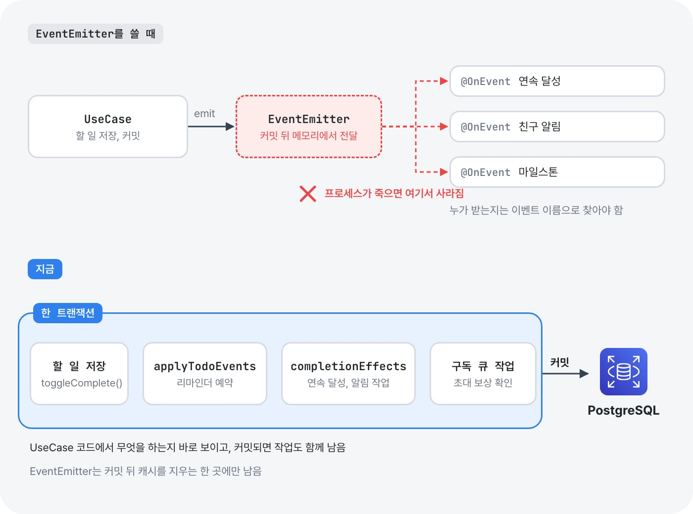

그래서 상태를 바꾸는 이벤트 전달은 모두 걷어 냈습니다. 같은 기능 안의 후속 처리는 UseCase가 직접 부르고 다른 기능이 반응해야 할 때는 같은 트랜잭션에 큐 작업을 넣습니다. EventEmitter는 표의 맨 아래 줄인 캐시 정리에만 남겼습니다.

### 친구 초대도 같은 방식으로

다른 기능이 큐 작업으로 반응하는 대표적인 예가 친구 초대입니다. 초대는 앱과 Next.js로 만든 랜딩 웹, API 서버 세 곳을 거칩니다.

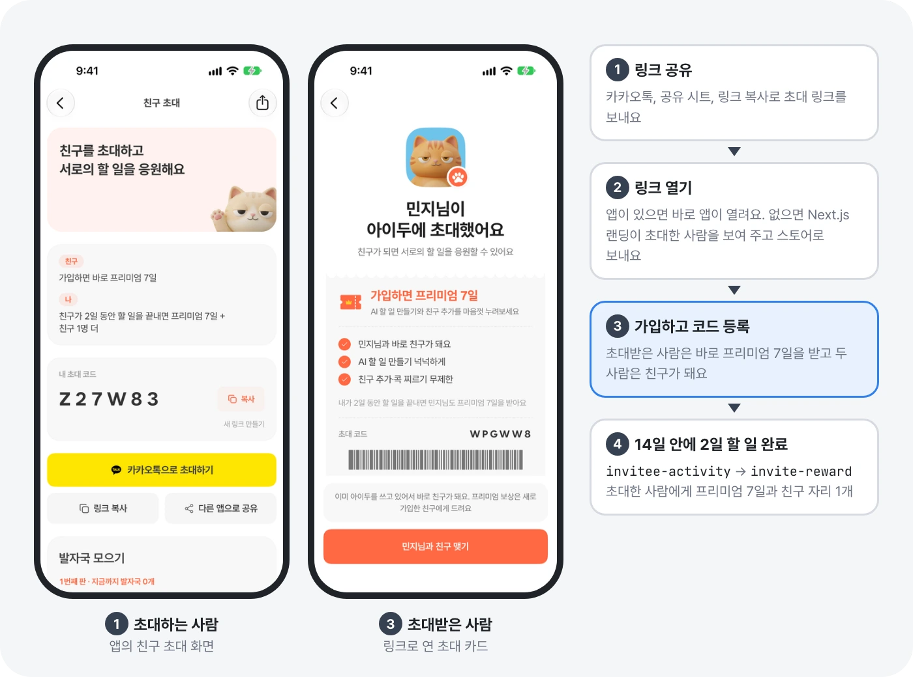

초대받은 사람은 가입하면서 바로 프리미엄 7일을 받습니다. 초대한 사람의 보상은 초대받은 사람이 14일 안에 서로 다른 2일 동안 할 일을 완료해야 갑니다. 할 일을 완료할 때마다 같은 트랜잭션에 "초대 활동 확인" 작업이 들어가고 조건을 채우면 보상 작업이 이어서 실행됩니다. 할 일 기능은 초대 기능을 전혀 모릅니다.

---

## Redis가 하던 나머지 일

작업 큐를 옮기고 나니 Redis가 하던 다른 일들도 PostgreSQL로 옮길 수 있겠다는 생각이 들었습니다.

| Redis가 하던 일 | 지금 맡고 있는 곳 |
| --- | --- |
| 작업 큐(BullMQ) | PostgreSQL 테이블에 작업을 저장하는 pg-boss |
| 분산 잠금 | PostgreSQL advisory lock |
| 같은 알림을 두 번 보내지 않게 막기 | PostgreSQL 부분 unique 인덱스 |
| 푸시 발송 횟수 제한 | PostgreSQL 조건부 upsert |
| 캐시와 요청 횟수 제한 | 서버 메모리(lru-cache) |

pg-boss를 들여다보면서 처음으로 PostgreSQL 문서를 제대로 읽었는데 Redis로 하던 일을 대신할 기능이 이미 거의 다 있었습니다. 앞의 UseCase에서 본 `mutationLock`은 트랜잭션이 끝나면 저절로 풀리는 잠금입니다.

```ts title="트랜잭션이 끝나면 풀리는 잠금" {2}
await this.#txHost.tx.execute(sql`
  SELECT pg_advisory_xact_lock(hashtextextended(ordered."key", 0))
  FROM ordered
  ORDER BY ordered."key"
`);
```

<p class="code-caption">postgres-mutation-lock.adapter.ts 일부</p>

Redis 잠금처럼 만료 시간을 맞추거나 풀지 못한 잠금을 걱정할 필요가 없습니다. 같은 알림을 두 번 보내지 않게 막는 일은 부분 인덱스가 맡습니다.

```sql title="리마인더 알림에만 거는 unique 인덱스" {3}
CREATE UNIQUE INDEX "Notification_todo_reminder_occurrence_dedup"
  ON "Notification" ("todoId", "type", (metadata ->> 'stage'), (COALESCE("reminderOccurrenceKey", '')))
  WHERE type = 'TODO_REMINDER' AND "todoId" IS NOT NULL;
```

<p class="code-caption">notification_reminder_occurrence/migration.sql 일부</p>

리마인더 알림에만 unique 조건을 걸어서 워커가 같은 리마인더를 두 번 처리해도 두 번째 저장은 DB가 막아 줍니다. 발송 한도는 조건부 upsert 한 문장으로 셉니다.

```ts title="한도 안에서만 사용량 올리기" {7,9}
await this.#txHost.tx
  .insert(outboundUsage)
  .values({ ...key, used: amount, updatedAt: at })
  .onConflictDoUpdate({
    target: [outboundUsage.meter, outboundUsage.periodKey, outboundUsage.subject],
    set: { used: sql`${outboundUsage.used} + ${amount}`, updatedAt: at },
    setWhere: sql`${outboundUsage.used} + ${amount} <= ${limit}`,
  })
  .returning({ used: outboundUsage.used });
```

<p class="code-caption">drizzle-usage-meter.adapter.ts 일부</p>

"한도를 넘지 않으면 올리고 새 값을 돌려줘"를 SQL 한 문장으로 끝냅니다. 한도를 넘으면 아무 행도 돌아오지 않으니 거절하면 됩니다. Redis에서 흔히 `INCR`로 하던 일입니다.

### PostgreSQL을 많이 쓰는 이유

여기까지 오고 나서야 처음의 궁금증에 조금 답할 수 있었습니다. 아이두에서 실제로 쓰고 있는 기능만 골라 MySQL 8과 비교해 봤습니다.

| 기능 | 아이두에서 쓰는 곳 | MySQL 8 |
| --- | --- | --- |
| 트랜잭션이 끝나면 풀리는 advisory lock | 같은 할 일을 동시에 바꾸지 못하게 잠금 | `GET_LOCK()`은 세션 단위라 직접 풀어야 합니다 |
| 부분 인덱스(`WHERE`가 붙은 인덱스) | 리마인더 중복 발송 방지 | 없습니다 |
| 조건부 upsert와 `RETURNING` | 발송 한도를 한 문장으로 예약 | `RETURNING`이 없어 다시 조회해야 합니다 |
| 데이터를 바꾸는 CTE | 푸시 발송 대기열을 잠그고 바로 상태 변경 | CTE 안에서 데이터를 바꿀 수 없습니다 |
| 역할별 기본 설정 | 앱 계정의 쿼리 시간 제한 | 계정별 세션 기본값이 없습니다 |
| 트랜잭션 안의 DDL | migration이 실패하면 전부 롤백 | DDL이 바로 커밋됩니다 |

`SKIP LOCKED`처럼 MySQL 8에도 있는 기능도 많으니 MySQL이 부족하다는 이야기는 아닙니다. 차이는 **PostgreSQL에는 이런 기능을 엮어 큐와 잠금을 DB 안에서 해결하는 도구가 이미 있다**는 데 있었습니다.

---

## 캐시는 서버 메모리로

마지막 남은 일은 캐시였습니다. 서버가 한 대라서 여러 서버가 캐시를 나눠 쓸 일이 없으니 서버 메모리 안의 캐시로 충분하다고 판단했습니다. 다만 Redis 어댑터를 지우지는 않았고 어느 쪽을 쓸지는 설정값 하나로 고릅니다.

```ts title="설정으로 고르는 캐시 저장소" {3-5}
useFactory: (cache, redis) => {
  const shared = selectSharedRedis(cache, redis);
  return shared == null
    ? new InMemoryCacheStore({ defaultTtlMs: cache.defaultTtlMs, maxItems: cache.maxItems })
    : new RedisCacheStore(shared, cache.defaultTtlMs);
},
```

<p class="code-caption">cache.module.ts 일부</p>

서버 메모리 캐시는 최대 3,000개, 기본 60초로 제한하고 자주 읽지만 조금 늦어도 괜찮은 값만 담습니다. 캐시를 읽다 실패하면 DB에서 다시 읽으니 캐시 때문에 서비스가 멈추는 일은 없습니다.

---

## RDS 하나로 무중단 배포

Redis를 걷어 내고 나니 서버는 EC2 한 대와 RDS 하나만 남았습니다.

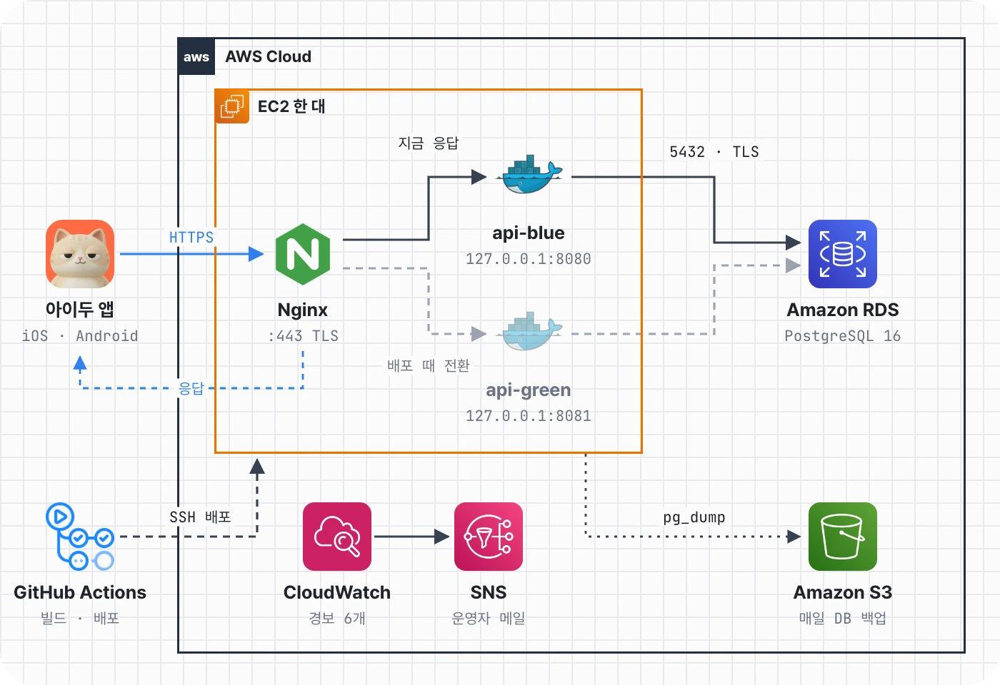

앱의 요청은 EC2 위의 Nginx가 받아 같은 서버 안의 API 컨테이너로 넘기고 CloudWatch 경보가 EC2와 RDS를 지켜봅니다. 남은 건 처음에 세운 두 번째 숙제입니다. 작업은 더 이상 사라지지 않지만 컨테이너를 내리고 새로 올리는 몇 초 사이에 들어온 요청은 여전히 실패했습니다.

ECS를 쓰면 새 컨테이너를 띄우고 ALB가 요청을 옮겨 줍니다. 하지만 이 일은 **같은 서버의 Nginx로도 충분했습니다.** API 컨테이너 자리를 `api-blue`와 `api-green` 두 개 두고 번갈아 쓰는 Blue-Green 배포입니다.

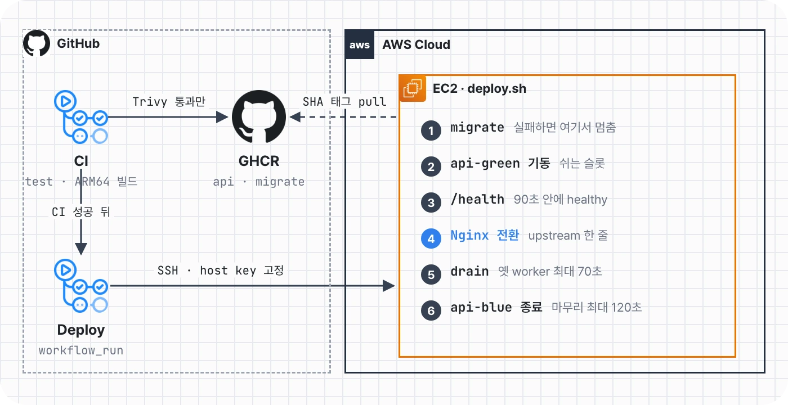

main에 머지하면 테스트와 보안 검사를 통과한 이미지만 올라가고 서버의 배포 스크립트가 여섯 단계를 차례로 실행합니다. 무중단을 만드는 건 네 번째 단계인 Nginx 전환입니다.

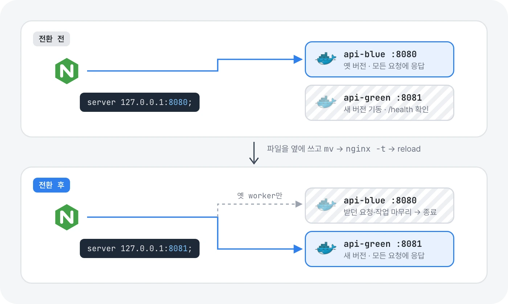

Nginx가 요청을 어느 컨테이너로 보낼지는 설정 파일 한 줄이 정합니다. 새 컨테이너가 준비되면 이 한 줄을 바꾸고 Nginx를 다시 읽힙니다.

```bash title="실패해도 살아 있는 쪽은 그대로 두는 배포" {7,13}
# migrate가 실패하면 여기서 멈춘다
compose run --rm --pull never migrate

log "새 API 기동"
if ! compose up -d --no-deps --pull never --wait --wait-timeout "$HEALTH_WAIT_S" "api-$next" \
  || ! curl -fsS -m 5 "http://127.0.0.1:$next_port/health" >/dev/null; then
  compose rm -sf "api-$next" >/dev/null || true
  fail "새 API가 healthy가 아니어서 지웠다. 살아 있는 슬롯($live_port)은 그대로다"
fi

log "Nginx 전환"
if ! point_nginx_at "$next_port"; then
  point_nginx_at "$live_port" || true
  fail "Nginx 전환 실패. 살아 있는 슬롯($live_port)으로 되돌렸다"
fi
wait_nginx_drain
```

<p class="code-caption">deploy.sh 일부</p>

어느 단계에서 실패하든 **지금 응답하고 있는 컨테이너는 건드리지 않습니다.** 새 컨테이너가 90초 안에 준비되지 않으면 새 컨테이너만 지우고 Nginx 전환이 실패하면 원래 자리로 되돌립니다.

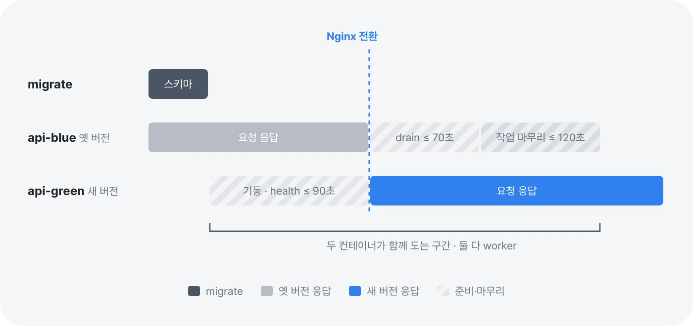

두 컨테이너는 같은 RDS를 씁니다. 그래서 DB 구조를 바꾸는 migration은 옛 코드도 그대로 돌 수 있는 변경만 합니다. 컬럼을 지우거나 이름을 바꾸지 않고 더하기만 하니 문제가 생기면 이전 버전을 다시 배포하는 것으로 되돌릴 수 있습니다.

### 두 컨테이너가 함께 도는 동안

전환하는 몇 분 동안은 두 컨테이너가 함께 돌고 둘 다 작업을 꺼내 처리합니다. 같은 리마인더를 두 번 보내지 않을까요?

여기서도 PostgreSQL이 답을 줍니다. pg-boss는 작업을 꺼낼 때 `SELECT ... FOR UPDATE SKIP LOCKED`를 씁니다. 한 컨테이너가 잠근 작업은 다른 컨테이너가 건너뛰니 작업 하나는 한 곳에서만 꺼냅니다. 옛 컨테이너는 종료 신호를 받으면 새 작업을 꺼내지 않고 하던 작업만 마저 끝내는데 그 여유는 Docker 설정에서 줍니다.

```yaml title="종료 여유와 자원 제한" {3}
x-api: &api
  # 하던 작업을 마칠 여유(pg-boss 90초 + 정리)
  stop_grace_period: 120s
  read_only: true
  cap_drop:
    - ALL
  deploy:
    resources:
      limits:
        memory: 512M
        cpus: '1'
```

<p class="code-caption">docker-compose.prod.yml 일부</p>

그래도 끝내지 못한 작업은 큐에 남았다가 새 컨테이너가 다시 실행합니다. 그래서 모든 작업은 두 번 실행돼도 결과가 같도록 만듭니다. 컨테이너는 메모리 512MB와 CPU 1개로 묶어서 한 컨테이너가 이상해져도 서버 전체가 함께 쓰러지지 않게 했습니다.

캐시는 사정이 조금 다릅니다. 두 컨테이너의 메모리 캐시는 서로를 모르니 그 사이에 바뀐 값은 다른 쪽 캐시가 만료될 때까지 몇 분 어긋날 수 있습니다. 이 틈은 PostgreSQL의 LISTEN/NOTIFY로 줄여 볼 생각입니다. 커밋할 때 연결된 서버들에 신호를 보내는 기능인데 모여에서는 이 신호로 웹 알림함을 실시간으로 새로 고치고 있습니다.

### 커넥션 풀과 DB 계정

RDS 하나를 두 컨테이너가 함께 쓰려면 커넥션 수도 계산해야 합니다.

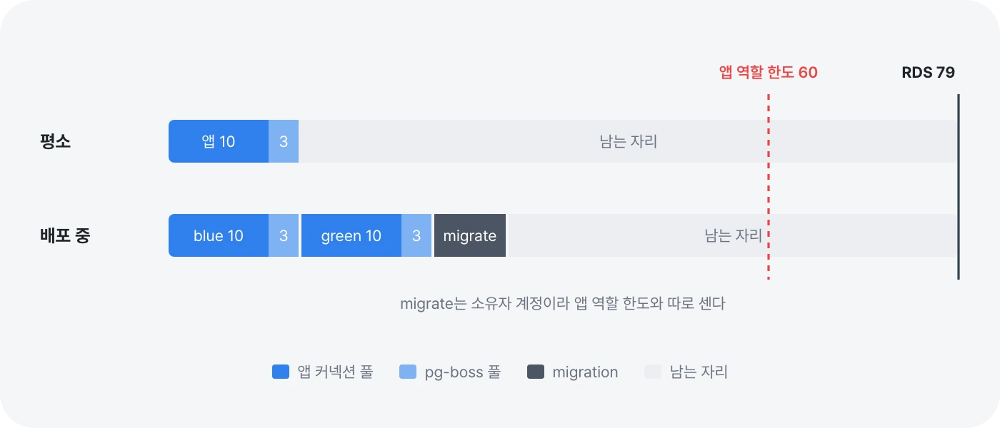

컨테이너 하나는 커넥션을 최대 13개(앱 10개, pg-boss 3개) 씁니다. 배포 중에 두 컨테이너가 겹쳐도 26개에 migrate가 더해지는 정도라 RDS 한도 79개 안에 넉넉히 들어옵니다. 앱 계정은 60개까지만 쓸 수 있게 막아서 운영자가 들어갈 자리도 남겼습니다.

한 요청이 커넥션을 몇 개 잡는지도 따져야 합니다. 트랜잭션은 커넥션 하나 위에서 돌기 때문에 그 안의 쿼리를 `Promise.all`로 묶어도 빨라지지 않습니다. 그래서 `Promise.all`은 트랜잭션 밖에서 서로 기다릴 필요가 없는 조회에만 씁니다.

```ts title="서로 상관없는 세 조회 함께 기다리기" {1}
const [stats, topTodos, streakContext] = await Promise.all([
  todoReadRepository.getTodayTodoStats(ownerId, date),
  todoReadRepository.findTodayTopTodos(ownerId, date, TODAY_SUMMARY_TOP_TODOS_MAX),
  streakPort.getStreakContext(ownerId),
]);
```

<p class="code-caption">get-todo-summary.use-case.ts 일부</p>

홈 화면의 오늘 요약은 세 조회를 동시에 실행하는 대신 요청 하나가 커넥션을 세 개까지 잡습니다.

> 이걸 놓쳐서 커넥션 풀이 바닥났던 경험은 [아직 출시도 안 했는데 커넥션 풀이 고갈됐다](/post/moyeo-connection-pool-exhaustion)에 따로 적어 두었습니다.

DB 계정도 둘로 나눴습니다. 예전에는 API가 테이블을 지울 수도 있는 소유자 계정으로 붙었습니다.

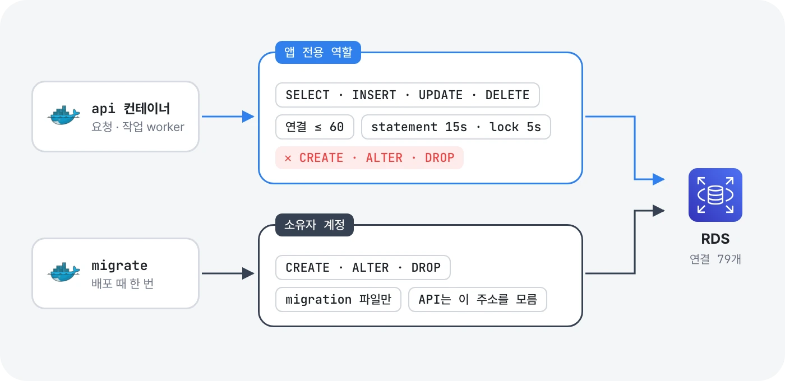

```sql title="앱 전용 DB 계정" {1-3}
ALTER ROLE aido_app WITH LOGIN NOCREATEDB NOCREATEROLE CONNECTION LIMIT 60;
ALTER ROLE aido_app SET statement_timeout = '15s';
ALTER ROLE aido_app SET lock_timeout = '5s';

-- 앞으로 만들 테이블에도 같은 권한
ALTER DEFAULT PRIVILEGES IN SCHEMA public, pgboss
  GRANT SELECT, INSERT, UPDATE, DELETE ON TABLES TO aido_app;
```

<p class="code-caption">app-role.sql 일부</p>

앞의 비교표에 있던 "역할별 기본 설정"이 이것입니다. 계정 자체에 쿼리 시간 제한을 걸어 두면 느린 쿼리 하나가 커넥션을 오래 붙잡지 못합니다.

---

## 걷어 내며 만난 세 가지 함정

여기까지만 보면 순조로워 보이지만 실제로는 세 번 발목을 잡혔습니다.

### pg-boss로 옮겨도 사라지던 알림

작업 큐를 pg-boss로 옮기고 나서 문제가 다 풀린 줄 알았습니다. 그런데 팔로우, 응원, 찌르기 알림은 여전히 사라질 수 있었습니다. 이 알림들은 트랜잭션이 커밋된 뒤에 따로 큐에 넣고 있었기 때문입니다. 큐는 PostgreSQL로 옮겼지만 커밋과 큐 등록 사이의 틈은 Redis 시절과 똑같이 남아 있었습니다.

앞의 표에서 "사라지면 안 되는 일"로 분류한 알림들입니다. 이것들도 업무 변경과 같은 트랜잭션 안에서 넣도록 바꾸고 나서야 틈이 닫혔습니다. **큐가 어디 있느냐보다 작업을 언제 넣느냐가 문제였습니다.**

### Nginx를 바꾼 직후의 502

Nginx 설정을 바꾸고 곧바로 옛 컨테이너를 내리면 어떻게 될까요? 로컬에서 전환을 연습해 보니 전환 직후 들어온 요청 일부가 [`502 Bad Gateway`](https://developer.mozilla.org/ko/docs/Web/HTTP/Status/502)를 받았습니다.

Nginx는 설정을 다시 읽어도 기존 워커를 바로 끄지 않고 받던 연결을 끝낼 때까지 남겨 둡니다. 그 사이 옛 워커는 여전히 옛 컨테이너로 요청을 보내는데 옛 컨테이너를 바로 내리면 이 요청들이 갈 곳을 잃습니다.

```bash title="옛 Nginx 워커가 빠질 때까지 기다리기" {2}
# proxy_read_timeout(60초)보다 길게
NGINX_DRAIN_WAIT_S=70

wait_nginx_drain() {
  for ((waited = 0; waited < NGINX_DRAIN_WAIT_S; waited++)); do
    [[ -n "$(comm -12 <(printf '%s\n' "$draining_workers") <(nginx_workers))" ]] || return 0
    sleep 1
  done
}
```

<p class="code-caption">deploy.sh 일부</p>

옛 워커가 모두 빠질 때까지 최대 70초를 기다립니다. Nginx가 응답을 기다리는 최대 시간이 60초라서 70초면 처리 중이던 요청은 모두 끝난 뒤입니다.

### 배포 중에 놓친 정기 작업

컨테이너가 바뀌는 순간에는 작업을 꺼내는 쪽이 잠깐 비어 있습니다. 예전에는 1분마다 도는 리마인더 확인 작업이 실행된 시각의 1분 동안만 확인했습니다. 그래서 배포 중에 한 번이라도 실행을 건너뛰면 그 1분 사이에 울려야 할 리마인더는 아무도 확인하지 않은 채 사라졌습니다. 그래서 모든 정기 작업에 놓친 실행을 어떻게 할지(`missed`)를 반드시 적게 했습니다.

```ts title="놓친 실행을 한 번 다시 돌리는 정기 작업" {6}
// 놓친 실행은 한 번만 다시 보낸다(실행은 멱등)
export const TODO_SERIES_MATERIALIZATION_QUEUE = defineQueue({
  name: "todo-series-materialization.v1",
  payloadSchema: todoSeriesMaterializationPayloadSchema,
  retry: { retryLimit: 2, retryDelaySeconds: 30, retryBackoff: true },
  schedules: [{ key: "daily-todo-series-materialization-scheduler", cron: "10 3 * * *", missed: "once" }],
});
```

<p class="code-caption">todo-series-materialization.queue.ts 일부</p>

리마인더 확인 작업은 여기에 하나를 더했습니다. 마지막으로 성공한 시각을 DB에 남겨 두고 다음 실행이 그때부터 지금까지를 최대 15분까지 한꺼번에 처리합니다. 15분보다 늦은 리마인더는 보내지 않습니다. 오전 9시 할 일 알림이 9시 20분에 오면 오히려 헷갈리기 때문입니다.

---

## 바깥 서비스가 멈출 때

서버 안의 작업을 잃지 않게 만들고 나니 다음 고민은 서버 밖이었습니다. 아이두는 말하거나 적은 내용을 할 일로 바꿀 때 Anthropic, Google, OpenAI의 AI 모델을 부릅니다. 이 중 한 곳이 멈추면 어떻게 될까요?

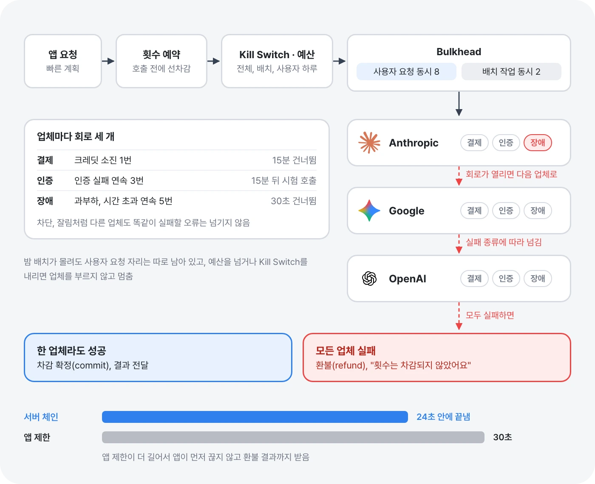

업체마다 서킷 브레이커를 세 개씩 두었습니다. 크레딧이 떨어지면 결제 회로, 인증이 실패하면 인증 회로, 과부하나 시간 초과가 이어지면 장애 회로가 열립니다. 회로가 열린 업체는 잠시 건너뛰고 다음 업체로 넘어갑니다. **한 업체가 멈춰도 할 일 만들기는 계속됩니다.**

돈이 걸린 일은 사라지면 안 된다는 원칙도 그대로 지킵니다. 이용 횟수는 호출 전에 미리 차감했다가 결과가 나오면 확정하고 모든 업체가 실패하면 돌려줍니다. 서버의 제한 시간은 앱보다 짧게 잡아서 앱이 먼저 끊지 않고 "횟수는 차감되지 않았어요"까지 받게 했습니다. 사용자 요청과 밤에 도는 리포트 작업은 동시에 부를 수 있는 자리를 따로 두었고 전체, 배치 작업, 사용자 하루 세 단계의 예산과 설정 하나로 호출을 멈추는 Kill Switch도 있습니다. 예산 사용량은 앞에서 본 조건부 upsert 테이블에 그대로 쌓입니다.

---

## 바꾸고 나서 달라진 것

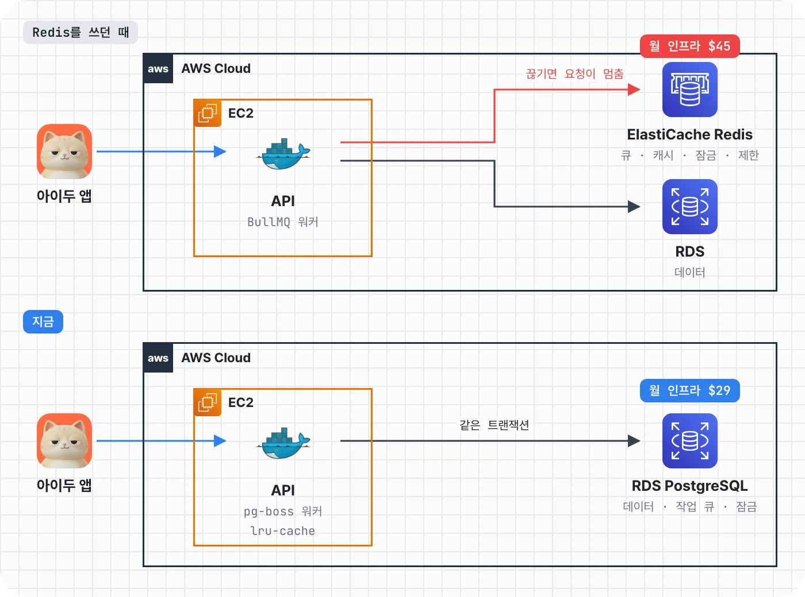

가장 먼저 비용이 줄었습니다. 캐시를 서버 메모리로 바꾸고 ElastiCache를 없애면서 월 인프라 비용이 $45에서 $29로 약 35% 줄었습니다.

Redis 연결이 끊겨 모든 요청이 멈추는 문제도 더는 일어나지 않습니다. 작업 큐와 잠금, 발송 제한이 모두 이미 쓰고 있던 DB 안으로 들어왔기 때문입니다. DB가 멈추면 어차피 서비스도 멈추니 지켜볼 저장소가 하나로 줄었습니다.

무엇보다 처음에 세운 두 숙제가 풀렸습니다. **사라지면 안 되는 일이 할 일과 함께 커밋됩니다.** 배포 중에 할 일을 완료해도 친구 알림은 조금 늦을 뿐 새 컨테이너가 보냅니다. 서버가 바뀌는 순간에도 Nginx가 요청을 살아 있는 컨테이너로 넘기니 사용자는 배포를 알아채지 못합니다.

대신 작업 처리량이 PostgreSQL에 묶이고 서버가 한 대라 서버 자체에 문제가 생기면 그동안은 요청을 받지 못합니다. 지금 규모에서는 충분하다고 판단했고 커질 때를 대비해 바꾸기 쉬운 구조를 만들어 두었습니다.

---

## 바꾸기 쉽게 만들어 둔 구조

처음부터 잘되는 서비스는 많지 않습니다. 그래서 처음부터 큰 인프라를 깔기보다 **작게 시작하되 나중에 쉽게 바꿀 수 있게** 만드는 쪽을 택했습니다. AI가 코드를 대신 써 주는 요즘, 돌아가는 코드는 누구나 만들 수 있지만 기획이 바뀌거나 사용자가 늘었을 때 어디를 고치면 되는지 보이는 구조는 아직 개발자가 설계해야 한다고 생각합니다.

아이두 서버는 할 일, 친구, 알림, 결제 같은 기능마다 폴더를 나누고 각 기능을 같은 네 칸으로 나눕니다.

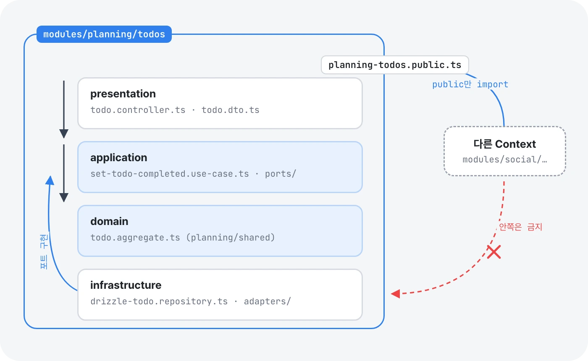

핵심은 포트(Port)와 어댑터입니다. 포트는 "무엇을 하는지"만 정해 둔 약속이고 "어떻게 하는지"는 어댑터가 맡습니다. 업무 코드는 포트만 알기 때문에 어댑터를 바꿔도 업무 코드는 그대로입니다.

예를 들어 운영자에게 가는 알림은 지금 Discord로 보냅니다. 하지만 업무 코드는 Discord를 모르고 "어느 채널로 무엇을 보낸다"는 약속만 압니다. Slack으로 옮기고 싶다면 어댑터를 만들어 표에 한 줄을 더하면 됩니다.

```ts title="운영 알림 포트와 어댑터 선택표" ins={11-12}
// 어디로 보내는지 모르는 포트
export abstract class AdminNotifierPort {
  abstract send(channel: AdminNotificationChannel, notice: AdminNotice): Promise<AdminNotifyOutcome>;
}

// 설정값으로 어댑터를 고른다
const adapters = {
  discord: (config, http, policies, clock) =>
    new DiscordAdminNotifierAdapter(config.discordWebhookUrls, http, policies, clock),
  log: () => new LogAdminNotifierAdapter(),
  slack: (config, http, policies, clock) =>
    new SlackAdminNotifierAdapter(config.slackWebhookUrls, http, policies, clock),
} satisfies Record<AdminNotifierProviderId, AdminNotifierFactory>;
```

<p class="code-caption">admin-notifier-selection.adapter.ts 일부, Slack 줄은 예시</p>

다른 바깥 서비스도 같은 방식입니다. 푸시는 지금 Expo로 보내지만 FCM으로 바꿔도 발송 큐와 재시도 로직은 그대로입니다. 앞에서 본 AI 업체 세 곳도 같은 포트 뒤에 있습니다. 결제는 RevenueCat이 보낸 데이터를 어댑터가 "구독 시작", "갱신", "만료" 같은 아이두의 말로 바꿔 넘기니 결제 서비스를 바꿔도 이 번역기만 새로 만들면 됩니다. 할 일 완료 UseCase 코드에 Drizzle이 한 번도 나오지 않았던 것도 같은 이유입니다. 실제로 ORM을 Prisma에서 Drizzle로 옮겼을 때도 주로 어댑터를 다시 쓰는 일이었습니다.

---

## 다음으로 미뤄 둔 확장

지금 구조는 서버를 늘리지 않는 쪽에 맞춰져 있습니다. 하지만 늘려야 할 때 무엇을 바꿀지는 미리 정해 두었습니다.

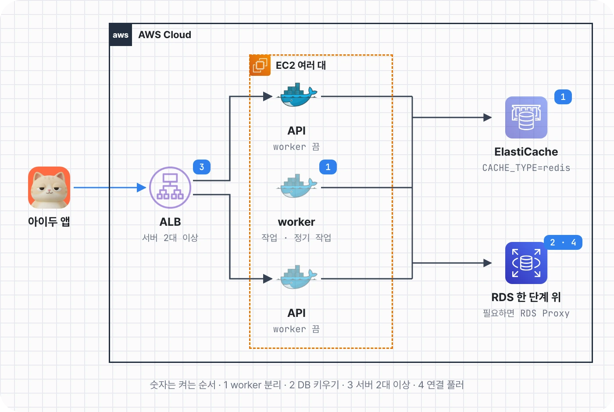

| 순서 | 이런 신호가 오면 | 이렇게 바꿉니다 |
| --- | --- | --- |
| 1 | 작업이 몰려 API 응답이 느려진다 | 작업을 처리하는 워커를 따로 떼고 캐시를 Redis 계열로 옮긴다 |
| 2 | RDS 메모리 경보가 울린다 | RDS를 한 단계 큰 것으로 올린다 |
| 3 | 서버 한 대로 버티기 어렵다 | ALB를 붙이고 서버를 늘린다 |
| 4 | DB 연결 수가 한도에 가까워진다 | PgBouncer나 RDS Proxy를 둔다 |

신호는 CloudWatch와 Sentry 경보가 먼저 알려 줍니다. 어느 단계든 바뀌는 건 설정과 인프라, 그리고 어댑터입니다. 캐시는 `CACHE_TYPE=redis` 한 줄이면 다시 Redis로 돌아갑니다. **Redis를 버린 게 아니라 필요할 때 꺼내 쓸 수 있게 넣어 둔 겁니다.**

---

## 마치며

처음에는 작업을 잃지 않으려면 Redis 같은 저장소를 하나 더 붙여야 한다고 생각했습니다. 하나씩 풀어 보니 필요한 건 새 부품이 아니라 **이미 쓰고 있던 PostgreSQL을 제대로 아는 것**이었습니다. 해외 강의에서 왜 그렇게 PostgreSQL을 쓰는지 이제야 조금 알겠습니다.

글을 마무리하던 즈음 세무사 시험 수석 합격자가 초소형 카메라와 생성형 AI로 답을 받아 적었다고 [자백했다는](https://www.hankookilbo.com/news/article/A2026111510180003684) 소식이 들려왔습니다. 경영학을 전공하며 회계사 시험을 잠깐 준비해 본 터라 응시자 평균이 30점대인 과목의 만점이 무슨 뜻인지는 어렴풋이 알았습니다. 그래서 놀랍기보다는 생각이 많아졌습니다. 외우고 이해해서 푸는 시험이 지금도 맞는 잣대인지, 시험의 모양부터 다시 그려야 하는 건 아닌지 말입니다. 이번 일을 계기로 교육은 물론 채용과 고용을 이어 가는 방식까지 기술의 속도에 뒤처지지 않고 하루빨리 발전했으면 합니다. 시대가 바뀌면 누군가는 손해를 보고 누군가는 기회를 얻기 마련입니다. 그 기회도 꾸준히 준비해 온 사람이라면 충분히 잡을 수 있다고 생각합니다.

어쩌면 이런 기회를 얻는 과정 중 하나는 지금처럼 회사 업무를 하든 개인적으로 사이드 프로젝트를 하든 발전하는 AI의 속도에 쫄지만 말고 안 해 본 일에 도전해 보는 것입니다. 지금은 그런 도전을 하기에 제일 좋은 시기이고 한 사람이 다양한 업무를 해낼 수 있는 시기이기도 합니다. 그래서 나만 가질 수 있는 강점과 경쟁력이 무엇인지 계속 고민하면서 현실에 안주하지 않고 무엇인가 도전해 보는 것이 지금 시대에 제일 중요하지 않을까 하는 개인적인 생각을 해 봅니다.

---

혹시 아이두가 궁금하신 분이 있다면 한 번 써 보셔도 좋겠습니다. 말하거나 적으면 AI가 할 일로 정리해 주고 친구와 서로의 할 일을 응원하면서 끝까지 해낼 수 있게 돕는 앱입니다. iPhone, Android, Mac, 태블릿에서 모두 쓸 수 있습니다.

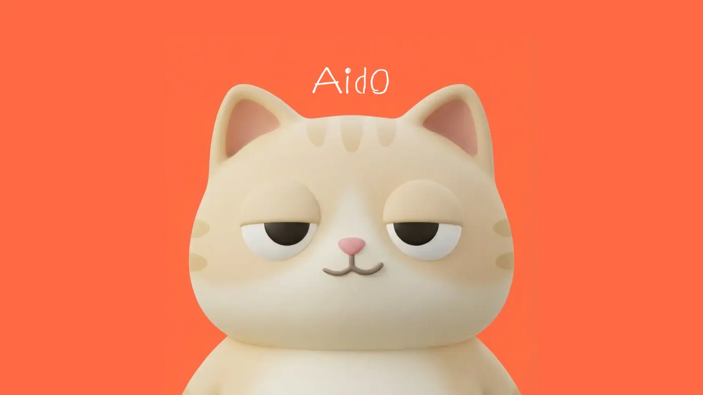

[App Store](https://apps.apple.com/kr/app/%EC%95%84%EC%9D%B4%EB%91%90-ai-%ED%88%AC%EB%91%90-%ED%94%8C%EB%9E%98%EB%84%88/id6757722325) | [Google Play](https://play.google.com/store/apps/details?id=com.aido.mobile&pcampaignid=web_share&pli=1) | [아이두(Aido) 공식 웹사이트](https://www.aido.kr/) | [공식 인스타그램](https://www.instagram.com/aiddoo_official/)
