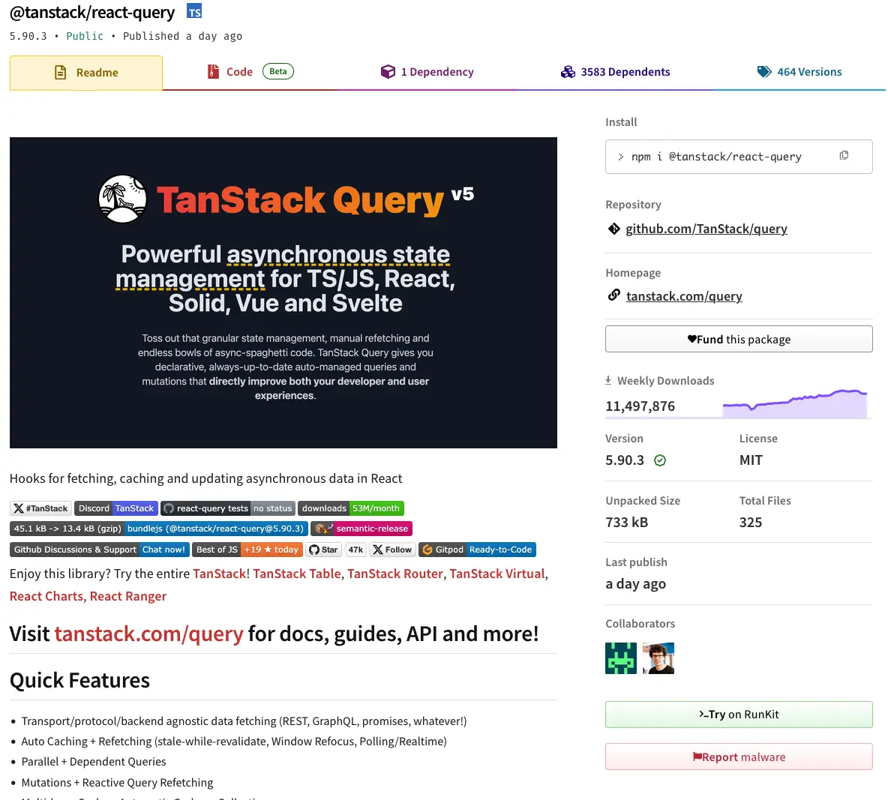
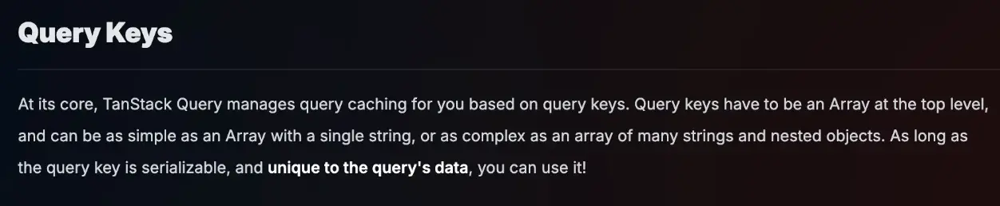
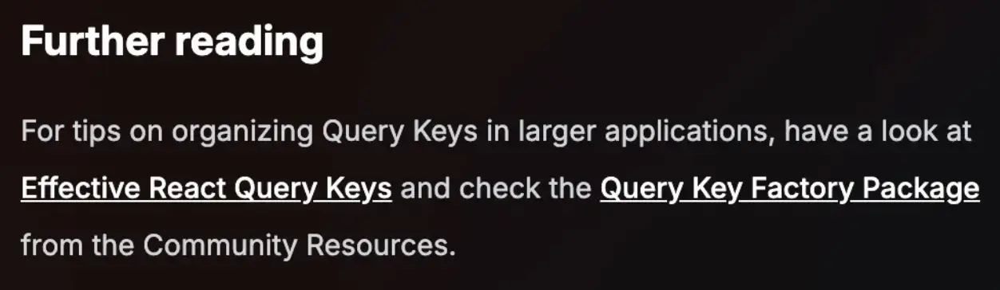
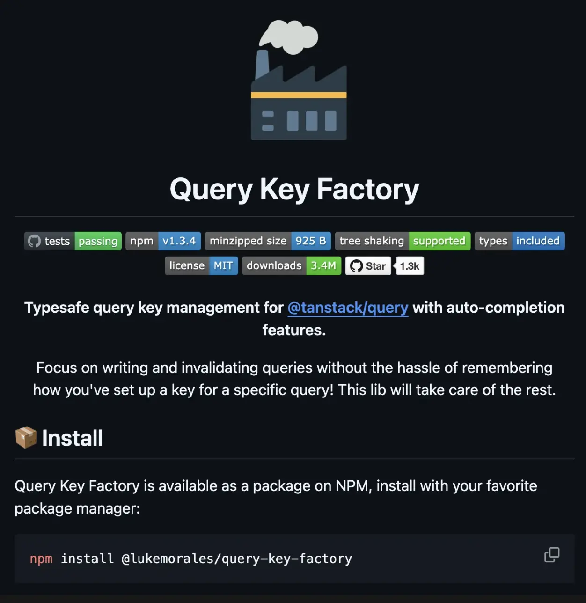
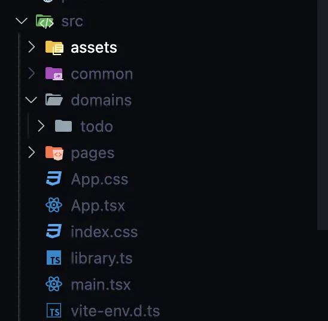

# 사건의 발단

> 🙆🏻‍♂️ 아마 대부분의 프론트엔드 개발자 분들은 Tanstack-Query라는 도구를 활용해서 비동기 상태 관리를 할 것입니다.

실제로 Tanstack-Query는 현재 (2025년 10월 15일 기준) 약 1150만회 이상 다운받아질 정도로 프론트엔드 개발자에게 있어서 필수 불가결한 라이브러리 중 하나입니다. (물론 SWR도... 있기는 한다 ^ㅁ^)



현재 운영중인 서비스에서도 Tanstack-Query를 매우 알차게 사용하고 있다.

많은 분들이 아시겠지만 Tanstack-Query를 도입하면 아래와 같은 장점을 얻게 된다.

1. 데이터 캐싱 및 상태 관리
2. 자동화된 데이터 동기화
3. 로딩/에러처리 (데이터 상태를) 쉽게 관리
4. 서버 상태와 클라이언트 상태를 분리
5. `QueryKey`를 활용함으로써 중복 요청을 방지
6. `Optimistic Update`, `Background Update`와 같은 최적화된 데이터 업데이트 (사용자 경험과 연관)
7. 개발 편의성 (`Query`, `Mutation`을 통한 직관적인 코드 작성, DevTool의 유용함)

물론 이 외에도 정말 많은 장점이 있겠지만, Tanstack Query를 도입하면 비동기 데이터 요청 및 캐싱이 많이 필요한 프로젝트에서 개발 속도와 유지보수성을 크게 향상시킬 수 있다.

---

## 그래서, 말하고자 하는게 뭐야?

위의 Tanstack-Query에 대한 장점을 잘 보면 `QueryKey`가 매우 중요한 역할을 하고 있다는 것을 알 수 있다!

실제로 아래 공식문서에서도 `QueryKey`의 중요성을 설명하고 있다!



### 쿼리 키 (Query Keys)

TanStack Query는 쿼리 키를 기반으로 쿼리 캐싱을 관리한다.

`QueryKey`는 최상위 수준에서 `배열(Array)` 형태를 가져야 하며, 단순히 문자열 하나로 구성된 배열일 수도 있고 여러 문자열과 중첩된 객체로 이루어진 복잡한 배열일 수도 있다.

`QueryKey`가 `직렬화 가능(serializable)`하고 쿼리 데이터에 고유하다면 어떤 형태로든 사용할 수 있다!

**뭐 대충, 엄청 중요하다는 의미입니다.**

사실 처음 개발을 할 때에는 `QueryKey`에 대한 중요성이 크게 느껴지지 않았다.

1. 전체 조회를 한다.

```js
const queryKeys = {
  todos: 'todos',
  challenges: 'challenges',
};
```

전체 조회만 있으면 이렇게 하면 괜찮을 것 같았다!

2. 상세 조회도 한다.

여기서 살짝 고민이 생겼다.

물론 일반적으로 `[todos, 1]` 이런식으로 `QueryKey`를 관리해도 되지 않을까 라는 생각을 했지만, 이러면 상세 페이지만 `invalidate(새로고침)`을 하고 싶은 경우가 대응이 어려워집니다.

그래서 생각한 `QueryKey`의 구조는 아래와 같아졌다.

```js
const queryKeys = {
  todos: {
    all: ['todos', 'all'],
    detail: (id: number) => ['todos', 'detail', id],
  },
  challenges: {
    all: ['challenges', 'all'],
    detail: (id: number) => ['challenges', 'detail', id],
  },
};
```

뭐, 여기까지는 그래도 대응 할 만 했다.

3. challenge의 종류가 생긴 경우? (영상 챌린지, 녹음 챌린지 등등)

여기서부터 이제 혼란이 오기 시작했다. 어떤식으로 관리해야지??

```js
const queryKeys = {
  challenges: {
    general: {
      all: ['challenges', 'all', 'general'],
      detail: (id: number) => ['todos', 'detail', 'general', id],
    },
    recording: {
      all: ['challenges', 'all', 'recording'],
      detail: (id: number) => ['todos', 'detail', 'recording', id],
    },
  },
};
```

물론 `filters`라는 파라미터를 전달받아서 `{ filters }` 형태로 `QueryKey`를 관리해도 될 것 같다고 생각했다!

그러나 현재 저희 서비스 뿐만 아니라 대부분의 서비스들은 계속 늘어나는 고객들의 요구사항과 편리함을 충족하기 위해서 기능을 추가할 것이고, 그에 따라 `QueryKey`의 변동이 정말 많이 일어날 것 같다고 생각했다.

현재 서비스의 크기 정도면 충분히 이런식으로 관리가 가능하다고 생각했지만, 앞으로 많은 직원들이 들어오거나 협업을 하는데에 있어서 `QueryKey`를 효율적으로 관리하는 기준을 잡는 것이 매우 필요하다고 생각했다.


### 자기 반성 🙇🏻‍♂️

`QueryKey`를 한번 빠르게 정리하고 싶었으나...

서비스 출시 이후 늘어나는 요구사항과 유저 에러들을 즉각 대응하느라 (핑계) 정말 시간이 남지 않아서 리팩토링을 하지 못했다.

> 이제는 진짜 할 것이다... (아래로...)

---

## 공식문서, 너는 어떻게 추천해주니?

자 진짜 리팩토링 한다...

일단 모를때는 공식문서부터 봐봅시다...



> For tips on organizing Query Keys in larger applications, have a look at Effective React Query Keys and check the Query Key Factory Package from the Community Resources.

**참고 자료**:

- [Effective React Query Keys](https://tkdodo.eu/blog/effective-react-query-keys)
- [Query Key Factory Package](https://www.npmjs.com/package/query-key-factory)

당연히 저말고도 많은 사람들이 비슷한 고민을 겪고 있고, 공식문서에서는 크게 2가지 방식을 추천해주셨다.

하나씩 알아보고자 한다.

---

## 1. Effective React Query Keys

Effective React Query Keys에서는 먼저 저의 뼈를 찌르는 문장으로 시작했다.

### 1. Colocate (코드 근처에 배치)

모든 `QueryKey`를 `/src/utils/queryKeys.ts`와 같은 글로벌 파일에 저장하는 것이 좋은 선택이라고 생각하지 않다.

대신 `QueryKey`를 관련된 쿼리와 가까운 위치에 배치한다.

예를 들면, 다음과 같은 구조입니다:

```js
src
  ├─ features
  │    ├─ Profile
  │    │    ├─ index.tsx
  │    │    ├─ queries.ts
  │    ├─ Todos
  │         ├─ index.tsx
  │         ├─ queries.ts
```

각 `queries.ts` 파일은 React Query와 관련된 모든 내용을 포함하며, 일반적으로 커스텀 훅만 export한다.

쿼리 함수와 `Query Key`는 지역적으로 관리된다.

이를 보며 일단 폴더 구조를 features 중심으로 변경해야겠다고 생각했다.

---

### 2. 항상 배열 형태의 Query Key 사용하기

`QueryKey`는 문자열 하나로도 정의할 수 있지만, 통일성을 위해 항상 `배열(Array)`을 사용하는 것이 좋다.

React Query는 내부적으로 문자열도 배열로 변환하므로 아래처럼 작성하는 것이 더 좋다:

```js
// 🚨 React Query가 내부적으로 ['todos']로 변환함
useQuery({ queryKey: 'todos' });

// ✅ 배열 형태로 작성
useQuery({ queryKey: ['todos'] });
```

**업데이트**: React Query v4부터는 모든 `Query Key`가 배열 형태여야 한다.

### 3. Query Key 구조 설계

`QueryKey`는 일반적인 수준에서부터 구체적인 수준까지 단계적으로 구조화하는 것이 좋다.

필요에 따라 세부적인 레벨을 추가하세요.

예를 들어, 필터링 가능한 ToDo 리스트와 세부 조회를 제공하는 경우는 아래와 같이 설계할 수 있다:

```js
['todos', 'list', { filters: 'all' }],
  ['todos', 'list', { filters: 'done' }],
  ['todos', 'detail', 1],
  ['todos', 'detail', 2];
```

이러한 구조를 사용하면 다음과 같은 이점이 있다:

1. `['todos']`: ToDo와 관련된 모든 데이터를 무효화할 수 있음
2. `['todos', 'list']`: 모든 리스트를 무효화할 수 있음
3. 특정 키를 지정하여 특정 리스트나 데이터를 갱신 가능

### 4. Mutation에서 유연한 업데이트

#### 1. 상세 정보와 리스트 업데이트

```js
function useUpdateTitle() {
  return useMutation({
    mutationFn: updateTitle,
    onSuccess: (newTodo) => {
      // ✅ 상세 데이터를 업데이트
      queryClient.setQueryData(['todos', 'detail', newTodo.id], newTodo);

      // ✅ 이 ToDo가 포함된 모든 리스트를 업데이트
      queryClient.setQueriesData(['todos', 'list'], (previous) =>
        previous.map((todo) => (todo.id === newTodo.id ? newTodo : todo))
      );
    },
  });
}
```

#### 2. 모든 리스트 무효화

구체적인 키를 설정하기 어려운 경우, 모든 리스트를 무효화하는 방식도 가능한다:

```js
function useUpdateTitle() {
  return useMutation({
    mutationFn: updateTitle,
    onSuccess: (newTodo) => {
      queryClient.setQueryData(['todos', 'detail', newTodo.id], newTodo);

      // ✅ 모든 리스트를 무효화
      queryClient.invalidateQueries({
        queryKey: ['todos', 'list'],
      });
    },
  });
}
```

#### 3. 활성 리스트를 제외한 무효화

URL에서 현재 필터를 읽어와 활성화된 리스트만 업데이트하고, 나머지 리스트는 무효화하는 방식:

```js
function useUpdateTitle() {
  // URL에서 현재 필터를 읽어오는 커스텀 훅
  const { filters } = useFilterParams();

  return useMutation({
    mutationFn: updateTitle,
    onSuccess: (newTodo) => {
      queryClient.setQueryData(['todos', 'detail', newTodo.id], newTodo);

      // ✅ 현재 보고 있는 리스트를 업데이트
      queryClient.setQueryData(['todos', 'list', { filters }], (previous) =>
        previous.map((todo) => (todo.id === newTodo.id ? newTodo : todo))
      );

      // 🥳 활성화된 리스트는 제외하고, 나머지 리스트를 무효화
      queryClient.invalidateQueries({
        queryKey: ['todos', 'list'],
        refetchType: 'none', // v4에서 사용
      });
    },
  });
}
```

---

## 2. Query Key Factory

사실 1번의 방법을 통해 `QueryKey`의 효율적 관리를 위해 기능별 폴더구조를 잡는게 중요한 것을 알 수 있게 되었지만, 개인적으로 `QueryKey`를 효율적으로 관리하는 부분에 대한 궁금증은 아직 해소되지 않았다.

공식문서에서 아래와 같은 라이브러리를 활용하는 것을 추천해주었기에 한번 바로 사용해보고자 했다.

> **참고 자료**: [Query Key Factory](https://github.com/lukemorales/query-key-factory)



#### 1. 표준화된 키 생성 (Standardized Keys)

`query-key-factory`를 사용하면 모든 키가 배열 형태로 표준화된다.

또한 직렬화 가능한 객체를 포함한 키를 생성할 수 있다.

```ts
export const todos = createQueryKeys('todos', {
  detail: (todoId: string) => [todoId],
  list: (filters: TodoFilters) => ({
    queryKey: [{ filters }],
  }),
});
```

```ts
// createQueryKeys 출력:
{
  _def: ['todos'],
  detail: (todoId: string) => {
    queryKey: ['todos', 'detail', todoId],
  },
  list: (filters: TodoFilters) => {
    queryKey: ['todos', 'list', { filters }],
  },
}
```

`queryKey`가 필요하지 않은 경우에는 `null`로 설정할 수도 있다:

```ts
export const users = createQueryKeys('users', {
  list: {
    queryKey: null,
    queryFn: () => api.getUsers(),
  },
});
```

---

#### 2. Query Key와 Query Option 동시 선언 (Generate the Query Options You Need)

`queryKey`와 `queryFn`을 함께 선언하여 필요한 Query Option을 바로 생성할 수 있다.

```ts
export const users = createQueryKeys('users', {
  detail: (userId: string) => ({
    queryKey: [userId],
    queryFn: () => api.getUser(userId),
  }),
});

export function useUserDetail(id: string) {
  return useQuery(users.detail(id));
}
```

---

#### 3. 문맥 기반 쿼리 생성 (Generate Contextual Queries)

특정 컨텍스트에 종속된 쿼리를 생성할 수 있다.

예를 들어 사용자의 좋아요 데이터를 가져오는 쿼리를 생성할 때 유용한다.

```ts
export const users = createQueryKeys('users', {
  detail: (userId: string) => ({
    queryKey: [userId],
    queryFn: () => api.getUser(userId),
    contextQueries: {
      likes: {
        queryKey: null,
        queryFn: () => api.getUserLikes(userId),
      },
    },
  }),
});

// => createQueryKeys output:
// {
//   _def: ['users'],
//   detail: (userId: string) => {
//     queryKey: ['users', 'detail', userId],
//     queryFn: (ctx: QueryFunctionContext) => api.getUser(userId),
//     _ctx: {
//       likes: {
//         queryKey: ['users', 'detail', userId, 'likes'],
//         queryFn: (ctx: QueryFunctionContext) => api.getUserLikes(userId),
//       },
//     },
//   },
// }

export function useUserLikes(userId: string) {
  return useQuery(users.detail(userId)._ctx.likes);
}
```

---

#### 4. 직렬화 가능한 키 스코프 정의 (Access to Serializable Keys Scope)

전체 키 스코프를 쉽게 액세스하고, 해당 컨텍스트의 캐시를 무효화할 수 있다.

```js
users.detail(userId).queryKey; // => ['users', 'detail', userId]
users.detail._def; // => ['users', 'detail']
```

---

#### 5. 단일 파일에서 Query Keys 선언 (Declare Your Query Keys in a Single File)

하나의 파일에서 QueryKeys를 선언하고 관리할 수 있다.

```ts
export const queries = createQueryKeyStore({
  users: {
    all: null,
    detail: (userId: string) => ({
      queryKey: [userId],
      queryFn: () => api.getUser(userId),
    }),
  },
  todos: {
    detail: (todoId: string) => [todoId],
    list: (filters: TodoFilters) => ({
      queryKey: [{ filters }],
      queryFn: (ctx) => api.getTodos({ filters, page: ctx.pageParam }),
    }),
  },
});
```

---

#### 6. 기능별로 Query Keys 선언 (Declare Your Query Keys by Feature)

기능별로 세분화하여 QueryKeys를 선언하고, 이를 하나의 객체로 병합할 수 있다.

```ts
// queries/users.ts
export const users = createQueryKeys('users', {
  all: null,
  detail: (userId: string) => ({
    queryKey: [userId],
    queryFn: () => api.getUser(userId),
  }),
});

// queries/todos.ts
export const todos = createQueryKeys('todos', {
  detail: (todoId: string) => [todoId],
  list: (filters: TodoFilters) => ({
    queryKey: [{ filters }],
    queryFn: (ctx) => api.getTodos({ filters, page: ctx.pageParam }),
  }),
});

// queries/index.ts
export const queries = mergeQueryKeys(users, todos);
```

---

#### 7. TypeScript 기반의 강력한 타입 안전성 (Type Safety and Smart Autocomplete)

타입스크립트와 통합되어 IDE에서 자동완성 및 강력한 타입 지원을 제공한다.

키의 구조나 출력 타입을 쉽게 확인할 수 있다.

**스토어의 Query Keys 타입 추론**

```ts
import {
  createQueryKeyStore,
  inferQueryKeyStore,
} from '@lukemorales/query-key-factory';

export const queries = createQueryKeyStore({
  /* ... */
});

export type QueryKeys = inferQueryKeyStore<typeof queries>;
```

**특정 기능의 Query Keys 타입 추론**

```ts
import {
  createQueryKeys,
  inferQueryKeys,
} from '@lukemorales/query-key-factory';

export const todos = createQueryKeys('todos', {
  detail: (todoId: string) => [todoId],
  list: (filters: TodoFilters) => ({
    queryKey: [{ filters }],
    queryFn: (ctx) => api.getTodos({ filters, page: ctx.pageParam }),
  }),
});

export type TodosKeys = inferQueryKeys<typeof todos>;
```

---

## 이젠 실전이다

항상 사내 프로젝트에 도입 이전에 직접 서버를 만들면서 개인적으로 먼저 작업을 한 후 효율적인 구조를 찾아보는 편입니다.

물론 제가 만든 구조가 정확한 정답은 아닐지라도, 이전보다 확실하게 개발하는데에 있어서 효율적이면 최대한 빠르게 리팩토링을 진행하고자 한다.

아래는 앞으로 사내 코드 도입에 진행 할 예시입니다.

1. 도메인을 기준으로 폴더 구조를 나누자.

이름은 중요하지 않다. 기능별 폴더 구조를 나누는게 중요하다고 느꼈다.

`features`든 `domains`든 기능을 기준으로 폴더 구조를 나누어야 겠다.



2. 기능별 쿼리키를 분리하여 `QueryKeyFactory`를 사용하는 구조로 변경하자.

```ts
import { createQueryKeyStore } from '@lukemorales/query-key-factory';
import { getAllTodos, getTodo } from '../services/todo.service';

export const todoKeys = createQueryKeyStore({
  todos: {
    getAll: (search?: string, limit?: number) => ({
      queryKey: [{ search }],
      queryFn: (ctx) =>
        getAllTodos({
          search,
          cursor: ctx.pageParam as number,
          limit,
        }),
    }),
    getById: (id: number) => ({
      queryKey: [id] as const,
      queryFn: () => getTodo(id),
    }),
  },
});
```

이렇게 라이브러리를 활용하면 매우 효율적으로 쿼리키를 관리할 수 있다.

3. 해당 키를 활용하여 hooks를 생성하자

일단은 `useQuery` / `useInfiniteQuery`를 활용하는 `queries` 폴더와, `useMutation`을 활용하는 `mutations` 폴더로 크게 나누었다.

```ts
// queries/todo.query.ts
import { useQuery } from '@tanstack/react-query';
import { todoKeys } from '../todo.key';

export const useGetTodoList = (search?: string, limit?: number) => {
  return useQuery({
    queryKey: todoKeys.todos.getAll(search, limit).queryKey,
    queryFn: todoKeys.todos.getAll(search, limit).queryFn,
  });
};

export const useGetTodo = (id: string) => {
  const parseIntId = parseInt(id);
  return useQuery({
    queryKey: todoKeys.todos.getById(parseIntId).queryKey,
    queryFn: todoKeys.todos.getById(parseIntId).queryFn,
  });
};
```

```ts
// mutations/todo.mutation.ts
import { useMutation } from '@tanstack/react-query';
import {
  deleteTodo,
  postTodo,
  updateTodoDoneStatus,
} from '../../services/todo.service';
import { queryClient } from '../../../../common/containers/QueryClientProvider';
import { todoKeys } from '../todo.key';

export function useCreateTodoMutation() {
  return useMutation({
    mutationFn: postTodo,
    onSuccess: () => {
      queryClient.invalidateQueries({
        queryKey: todoKeys.todos.getAll().queryKey,
      });
    },
  });
}

export function useDeleteTodoMutation() {
  return useMutation({
    mutationFn: deleteTodo,
    onSuccess: () => {
      queryClient.invalidateQueries({
        queryKey: todoKeys.todos._def,
      });
    },
  });
}

export function useUpdateTodoDoneStatusMutation() {
  return useMutation({
    mutationFn: updateTodoDoneStatus,
  });
}

export function useTodo() {
  const create = useCreateTodoMutation();
  const remove = useDeleteTodoMutation();
  const updateStatus = useUpdateTodoDoneStatusMutation();
  return {
    create,
    remove,
    updateStatus,
  };
}
```

4. 잘 사용해보자, 전체 키를 invalidate 할지, 특정 게시글만 invalidate 할지, 효율적으로 쿼리키를 활용하자.

```ts
import { useNavigate } from 'react-router-dom';
import { useGetTodoList } from '../features/todo/hooks/queries/todo.queries';
import { useState } from 'react';
import { useTodo } from '../features/todo/hooks/mutations/todo.mutation';
import { queryClient } from '../common/containers/QueryClientProvider';
import { todoKeys } from '../features/todo/hooks/todo.key';

export default function TodosPage() {
  const navigate = useNavigate();

  const [title, setTitle] = useState < string > '';
  const [search, setSearch] = (useState < string) | (undefined > undefined);
  const { data: todos } = useGetTodoList(search);
  const { create, remove, updateStatus } = useTodo();

  return (
    <div>
      <div
        style={{
          display: 'flex',
          flexDirection: 'column',
          gap: 10,
        }}
      >
        <input
          type='text'
          value={search}
          onChange={(e) => setSearch(e.target.value)}
          placeholder='검색어를 입력해주세요.'
        />
        <div>
          <input
            type='text'
            value={title}
            onChange={(e) => setTitle(e.target.value)}
            placeholder='투두 제목 입력 해주세요.'
          />
          <button
            onClick={() =>
              create.mutate({
                title,
                content: 'content',
              })
            }
          >
            투두 생성
          </button>
        </div>
      </div>
      {todos?.data.todos.map((todo) => (
        <div
          onClick={() => navigate(`/${todo.id}`)}
          style={{
            cursor: 'pointer',
            padding: 10,
            border: '1px solid black',
            margin: 10,
            display: 'flex',
            justifyContent: 'center',
            alignItems: 'center',
          }}
        >
          <h1>{todo.title}</h1>
          <p>{todo.content}</p>
          <input
            type='checkbox'
            defaultChecked={todo.done}
            onClick={(e) => {
              e.stopPropagation();
              updateStatus.mutate(todo.id);
            }}
          />
          <button
            onClick={(e) => {
              e.stopPropagation();
              remove.mutate(todo.id, {
                onSuccess: () => {
                  queryClient.invalidateQueries({
                    queryKey: todoKeys.todos.getById(todo.id).queryKey,
                  });
                },
              });
            }}
          >
            삭제
          </button>
        </div>
      ))}
    </div>
  );
}
```

---

## 마무리

그동안 `QueryKey` 관리에 대한 많은 고민이 있었는데 공식문서와 다양한 블로그, 라이브러리들을 탐방하며 다양한 해결책을 알아낼 수 있었다.

효율적인 `QueryKey` 관리에 대해 고민하며 기존 서비스의 폴더 구조의 유지보수 어려움에 대한 문제점도 발견하여 고칠 수 있는 소중한 기회가 되었다.

더 나아가 `Optimistic Update`를 통한 User Experience를 향상 시키기 위한 작업을 진행하려고 했는데, 이때 `QueryKey`에 대한 문제가 있었는데 이번 기회에 이를 쉽게 해결하고 원하던 `Optimistic Update`를 조금 더 쉽게 적용할 수 있게 될 것 같다.

저처럼 혹시라도 `QueryKey` 관리에 대해서 많은 고민을 한 사람에게 조금이나마 이 게시글이 도움이 되셨으면 좋겠다!

효율적인 `QueryKey` 관리에 대해 (폴더구조 등) 좋은 경험을 갖고 계신다면 댓글은 언제나 환영입니다!!

아래는 직접 사내 프로젝트 도입전 혼자 Nest.js로 서버를 만들어가며 QueryKeyFactory 테스트를 해보는 영상이니, 위의 블로그 글이 이해가 안간다면 조금씩 참고해보셔도 좋을 것 같다!

https://youtu.be/O_G-oQ1_Zag?si=oCKpbzskrnXJeHd0
