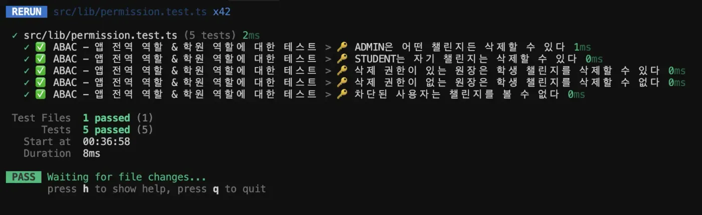

# 과거에 내가 작성한 코드가 주는 고통

우리 팀이 만드는 서비스는 처음엔 `역할 기반 권한 관리(RBAC)` 만으로도 충분했다.
그런데 서비스가 성장하면서 다양한 예외 케이스가 쏟아지고, 역할만으로는 설명이 안 되는 권한이 점점 많아졌다.

그때 발견한 것이 바로 `속성 기반 권한 관리(ABAC)` 였다.
이 글에서는 RBAC과 ABAC의 차이를 정리하고,
우리 서비스에서 ABAC으로 리팩토링한 과정과 권한 관리의 시행착오를 공유해보려 한다.

---

## 📖 RBAC vs ABAC — 핵심만 짚고 가기

|      | **RBAC**                  | **ABAC**                                                    |
| ---- | ------------------------- | ----------------------------------------------------------- |
| 정의 | Role-Based Access Control | Attribute-Based Access Control                              |
| 기준 | 사람의 **역할(Role)**     | 사람과 리소스의 **속성(Attribute)**                         |
| 예시 | `ADMIN이면 글 삭제 가능`  | `PRINCIPAL이고, 학원에 canDeleteChallenge=true면 삭제 가능` |

**👉 핵심:**

- **RBAC**: 심플해서 좋지만, 서비스가 커지면 한계가 옴.
- **ABAC**: 조건과 속성을 함께 고려해 더 유연한 권한 부여 가능.

---

# 📌 그래서 뭐가 문제인가 — 권한 관리를 둘러싼 소소하지만 무시무시한 이야기

**초기 기획**

**챌린지는 학원 내부에서 학생만 참여 가능! (원장과, 선생님은 쓸 수 없음)**

## 📅 **1차 개발 — MVP 오픈 전날**

**PM:**

> “학생은 자기가 쓴 챌린지만 삭제할 수 있어요!”

**FE 개발자:**

> “네 알겠다, 혹시 그 이후에 특정 역할의 사람이 챌린지 글을 삭제할 수 있을일이 추가될까요?”

**PM:**

> “아뇨아뇨 없을 것 같아요!”

```tsx
import { useUser } from '@/hooks/useUser';

export default function ChallengeDetail({ challenge }) {
  const user = useUser();

  const isOwner = user.id === challenge.ownerId;

  return (
    <div>
      <h1>{challenge.title}</h1>
      <p>{challenge.content}</p>
      {isOwner && <button onClick={handleDelete}>삭제</button>}
    </div>
  );
}
```

> 음.. 뭐 이 정도야 쉽지.

---

## 📅 **2차 — PM 금요일 밤 DM**

**PM:**

> “앗 개발자님! 요즘 원장님들이 학생들이 이상한 챌린지 글 올렸다고 지워달라는 연락이 점점 많아지고 있어요… 그런데 원장님들은 삭제 권한이 없고 결국 저희 쪽으로 문의가 와서 번거롭더라고요 😥”
>
> “일단 지금은 저희 회사 관리자(ADMIN)도 다른 학원의 학생들의 챌린지를 삭제할 수 있도록 좀 열어두면 좋겠어요! 학생은 본인 글만 삭제 가능하고, 저희 회사 관리자는 어떤 학원의 학생이 올린 챌린지 글이더라도 삭제 가능하게요!”

**FE 개발자:**

> 음?? 그냥 원장 선생님도 삭제권한을 드릴까요?? (그냥 그렇다 해주세요)

**PM:**

> 아니요!!
> 일단은 회사 관리자(ADMIN) 계정으로 다른 학원의 학생들의 챌린지를 삭제할 수 있도록 해주시면 충분할 것 같아요!!

**FE 개발자:**

> 넵넵 그럼 해당 기능 추가하겠다!

```tsx
import { useUser } from '@/hooks/useUser';

export default function ChallengeDetail({ challenge }) {
  const user = useUser();

  // 본인이 쓴 글
  const isOwner = user.id === challenge.ownerId;
  // 관리자 계정
  const isAdmin = user.appRole === 'ADMIN';

  const canDelete = isOwner || isAdmin;

  return (
    <div>
      <h1>{challenge.title}</h1>
      <p>{challenge.content}</p>
      {canDelete && <button onClick={handleDelete}>삭제</button>}
    </div>
  );
}
```

> 오… 뭔가 더 복잡해질 것 같은데..

---

## 📅 **3차 — 월요일 아침 DM**

**PM:**

> “안녕하세요! 정말 죄송하지만 마지막으로 하나 더 부탁드려요!
>
> 원장님(PRINCIPAL) 권한을 가진 분들도 자기 학원에서 학생들이 올린 챌린지는 자유롭게 삭제할 수 있게 해주세요!
>
> 저희가 다른 업무때문에 지속적으로 CS 처리하기도 쉽지 않고, 그냥 이전에 말씀해주신 것 처럼 원장님들이 직접 지우시게 하는게 더 좋은 방향성 같아요!

**FE 개발자:**

> (..? 저번에 추가 안된다며요 🤔)
>
> 네, 알겠다! 학원별 원장님 권한도 본인 학원의 학생들 챌린지는 삭제 가능하게 수정하겠다.

```tsx
import { useUser } from '@/hooks/useUser';

export default function ChallengeDetail({ challenge }) {
  const user = useUser();

  // 본인이 쓴 글
  const isOwner = user.id === challenge.ownerId;
  // 관리자 계정
  const isAdmin = user.appRole === 'ADMIN';
  // 본인 학원에서의 역할이 원장인 경우
  const isPrincipal = user.academyRoles[challenge.academyId] === 'PRINCIPAL';

  const canDelete = isOwner || isAdmin || isPrincipal;

  return (
    <div>
      <h1>{challenge.title}</h1>
      <p>{challenge.content}</p>
      {canDelete && <button onClick={handleDelete}>삭제</button>}
    </div>
  );
}
```

> 오… 점점 꼬인다?

---

## 📅 **4차 — 화요일 새벽 DM**

**PM:**

> “근데… 원장님이 한 학원에 여러 명 있을 수 있잖아요.
>
> 그중에서 삭제 기능 권한이 없는 원장님도 있어요.
>
> 그런 원장님들은 삭제 버튼을 못 누르게 해주세요!”

**FE 개발자:**

> 네… 알겠다.
>
> 그 부분은 백엔드에서 **원장별 챌린지 삭제 권한 여부**를 내려주셔야 할 것 같아요.
>
> 지금은 단순히 역할(PRINCIPAL)만 내려오고 있어서, 삭제 가능 여부 플래그 같은 세부 권한 데이터가 필요해요.
>
> 백엔드랑 협의해서 해당 데이터 받는 형태로 수정하고, 그걸 기반으로 버튼 노출 여부 처리하겠다.

**(속으로: 진작 얘기하지 이걸 이제 와서…)**

```tsx
import { useUser } from '@/hooks/useUser';

export default function ChallengeDetail({ challenge }) {
  const user = useUser();

  const isOwner = user.id === challenge.ownerId;
  const isAdmin = user.appRole === 'ADMIN';
  const isPrincipal = user.academyRoles[challenge.academyId] === 'PRINCIPAL';
  // 백엔드한테 canDeleteChallenge를 받았다.
  const canPrincipalDelete =
    isPrincipal &&
    user.academyRolesDetail[challenge.academyId]?.canDeleteChallenge;

  const canDelete = isOwner || isAdmin || canPrincipalDelete;

  return (
    <div>
      <h1>{challenge.title}</h1>
      <p>{challenge.content}</p>
      {canDelete && <button onClick={handleDelete}>삭제</button>}
    </div>
  );
}
```

> 이제부터 조건이 꽤 복잡해지고 유지보수가 무섭기 시작함…

---

## 🚀 결국 대대적인 리팩토링 시작

최근 우리 서비스의 **v2 버전 출시 준비**를 하면서 자연스럽게 권한 체계를 다시 설계하게 됐다.

v1에서는 `PRINCIPAL`이면 무조건 삭제 가능, `STUDENT`는 무조건 삭제 불가… 같은 단순한 권한 구조였는데,

**v2에서는 원장님도 삭제 권한이 없는 경우가 생기고**, 학원마다 다른 권한을 줘야 하는 상황이 오면서 기존 방식으로는 더 이상 유연하게 대응하기 어려워졌죠.

그래서 많이 고민하고 유튜브나, Medium 블로그 글을 찾아보고, 참고하면서 아래와 같이 `ABAC`을 처리하는 방식으로 리팩토링을 진행하게 됐다.

**핵심은**

✅ 권한을 **앱 전역 권한**과 **학원 권한**으로 분리하고,

✅ 각 권한의 세부 액션 별로 **boolean 혹은 커스텀 로직**으로 처리하는 방식입니다.

---

## 📌 기존 문제점

- **역할 단위로 권한을 하드코딩**
  - `if (user.role === 'PRINCIPAL')`
  - → 원장마다 권한이 다를 수 있는데 이걸 코드마다 if로 처리할 수 없음
- **학원 단위 권한이 없음**
  - 한 사람이 여러 학원에 소속되어 있을 수 있고, 학원마다 역할이 다른데 그걸 고려할 수 없음
- **권한 확인 로직이 여기저기 흩어짐**
  - 기능마다 권한 확인하는 방식이 제각각 → 유지보수 지옥

---

## ⚡️ 새 권한 시스템 구조

### 🍠 권한 개념 정리

- **앱 전역 권한(AppRole)**
  - 서비스 전체에서 적용되는 권한 (ex. ADMIN)
- **학원 권한(AcademyRole)**
  - 특정 학원 내에서의 역할 (ex. PRINCIPAL, TEACHER, STUDENT)
- **리소스(Resource)**
  - 권한을 체크할 대상 (ex. Challenge)
- **액션(Action)**
  - 해당 리소스에 대해 하고 싶은 행위 (ex. view, create, update, delete)

## 📌 전체 코드 구성 설명

### 🗂️ 역할, 리소스, 액션 정의

```tsx
export type AppRole = 'ADMIN' | 'USER';
export type AcademyRole = 'PRINCIPAL' | 'TEACHER' | 'STUDENT';

export type Challenge = {
  id: string;
  title: string;
  content: string;
  ownerId: string;
  academyId: string;
};
```

→ **추가적인 리소스, 역할을 선언하고 싶으면 여기만 수정하면 됨**

---

### 🧑 사용자 구조 정의

```tsx
export type User = {
  id: string;
  appRole: AppRole;
  blockedBy: string[];
  academyRoles: {
    [academyId: string]: AcademyRole;
  };
  academyRolesDetail?: {
    [academyId: string]: {
      canDeleteChallenge?: boolean;
    };
  };
};
```

→ 학원마다 다른 권한 세부 설정을 위해 `academyRolesDetail`를 추가

---

### 🏷️ 권한 정책 테이블

**앱 전역 권한**

```tsx
export const APP_ROLES: RolesWithPermissions = {
  ADMIN: {
    challenges: {
      view: true,
      create: true,
      update: true,
      delete: true,
    },
  },
  USER: {
    challenges: {
      view: (user, challenge) => !user.blockedBy.includes(challenge.ownerId),
      create: true,
      update: (user, challenge) => user.id === challenge.ownerId,
      delete: (user, challenge) => user.id === challenge.ownerId,
    },
  },
};
```

**학원 권한**

```tsx
export const ACADEMY_ROLES: AcademyRolesWithPermissions = {
  PRINCIPAL: {
    challenges: {
      delete: (user, challenge) => {
        const role = user.academyRoles[challenge.academyId];
        const detail = user.academyRolesDetail?.[challenge.academyId];
        return role === 'PRINCIPAL' && detail?.canDeleteChallenge === true;
      },
    },
  },
  TEACHER: {
    challenges: {
      delete: false,
    },
  },
  STUDENT: {
    challenges: {
      delete: (user, challenge) => user.id === challenge.ownerId,
    },
  },
};
```

### 📌 포인트

- 값은 **boolean** 또는 **커스텀 함수**
- 상황에 따라 **유저 정보와 리소스 정보**를 받아 권한 여부를 동적으로 판단 가능

---

### ✅ hasPermission 유틸 함수

모든 권한 확인은 이 함수로 통일한다.

```tsx
export function hasPermission<Resource extends keyof Permissions>(
  user: User,
  resource: Resource,
  action: keyof Permissions[Resource],
  data?: Permissions[Resource]['dataType']
): boolean {
  // 앱 권한 우선 검사
  const appPermission = APP_ROLES[user.appRole]?.[resource]?.[action];
  if (typeof appPermission === 'function') {
    return appPermission(user, data);
  }
  if (typeof appPermission === 'boolean') {
    if (appPermission) return true;
  }

  // 학원 권한 검사
  const academyRole = data?.academyId
    ? user.academyRoles[data.academyId]
    : null;
  if (!academyRole) return false;

  const academyPermission = ACADEMY_ROLES[academyRole]?.[resource]?.[action];
  if (typeof academyPermission === 'function') {
    return academyPermission(user, data);
  }
  if (typeof academyPermission === 'boolean') {
    return academyPermission;
  }

  return false;
}
```

---

### 리팩토링 후기

기존 코드는 실제로 권한 로직이 UI 레벨에 퍼져 있었다.

```tsx
const isOwner = user.id === challenge.ownerId;
const isAdmin = user.appRole === 'ADMIN';
const isPrincipal = user.academyRoles[challenge.academyId] === 'PRINCIPAL';
const canPrincipalDelete =
  isPrincipal &&
  user.academyRolesDetail[challenge.academyId]?.canDeleteChallenge;

const canDelete = isOwner || isAdmin || canPrincipalDelete;
```

리팩토링 후에는 이제 아래와 같이 작성할 수 있다.

```tsx
const canDelete = hasPermission(user, 'challenges', 'delete', challenge);
```

권한 조건이 UI에 섞이지 않고, 권한 테이블에만 정의되어 있고

어디서든 일관되게 **`hasPermission`** 한 줄로 체크를 할 수 있다.

전체 코드를 비교하면 훨씬 직관적으로 변경한 것을 확인할 수 있다.

```tsx
import { useUser } from '@/hooks/useUser';
import { hasPermission } from '@/permissions/hasPermission';

export default function ChallengeDetail({ challenge }) {
  const user = useUser();

  const canDelete = hasPermission(user, 'challenges', 'delete', challenge);

  return (
    <div>
      <h1>{challenge.title}</h1>
      <p>{challenge.content}</p>
      {canDelete && <button onClick={handleDelete}>삭제</button>}
    </div>
  );
}
```

이제 앞으로 **권한 정책이 바뀌어도** `APP_ROLES`**,** `ACADEMY_ROLES` **테이블만 수정하면 비교적 쉽게 권한 문제를 처리할 수 있다.**

프론트엔드도 가독성/유지보수성 다 올라가고, 기획 쪽에서 **“원장만 삭제 가능하게 해주세요”** 같은 요청이 들어오면 서버에서 관련 데이터를 제공 받고 있다면 비교적 손쉽게 권한문제를 처리하여 바로 배포할 수 있다.

---

## 📌 사실, 한 가지 더 문제가 있었다

서비스를 개발하다 보면 기능이 추가될수록 기존 코드가 깨지는 경험을 많이 하게 된다.

예를 들어, 원장 선생님도 챌린지를 삭제할 수 있게 권한을 열어줬는데, 그러다 보니 **자기 게시글은 삭제 잘 되던 게 원장 권한 추가하면서 갑자기 삭제가 안 된다거나,**

혹은 권한 조건이 점점 복잡해지면서 **다른 사람이 코드를 읽어도 맥락을 바로 이해하지 못하는 상황**이 종종 발생했다.

권한은 특히 UI와 서버 양쪽에서 **상황에 따라 예외처리가 많다 보니** 로직이 흩어지고 꼬이기 딱 좋은 영역입니다.

---

## 🤔 그래서, 테스트 코드를 추가했다

결국 권한 로직을 리팩토링한 것도 좋은데, **이 로직이 제대로 동작하는지, 새로운 정책이 추가될 때 기존 정책이 망가지지 않는지** 확인할 수 있는 장치가 필요했다.

바로 **테스트 코드**. 근데 테스트 코드를 작성해보니 또 좋은 게 있었다.

> 👉 테스트 코드는 결국 내가 짠 코드에 대한 설명서 역할을 한다.
>
> 즉, 테스트 케이스만 봐도 이 권한 로직이 어떻게 동작하는지 쉽게 파악 가능.
> 물론 덤으로 코드 안정성도 확보할 수 있었다. 😀

```tsx
import { describe, it, expect } from 'vitest';
import { hasPermission, type User, type Challenge } from './permission';

describe('✅ ABAC - 앱 전역 역할 & 학원 역할에 대한 테스트', () => {
  const 챌린지: Challenge = {
    id: 'c1',
    title: 'ABAC 테스트',
    content: '테스트용 내용',
    ownerId: 'student1',
    academyId: 'A1',
  };

  const 관리자: User = { ... };
  const 학생: User = { ... };
  const 삭제권한있는원장: User = { ... };
  const 삭제권한없는원장: User = { ... };

  it('🔑 ADMIN은 어떤 챌린지든 삭제할 수 있다', () => {
    expect(hasPermission(관리자, 'challenges', 'delete', 챌린지)).toBe(true);
  });

  it('🔑 STUDENT는 자기 챌린지는 삭제할 수 있다', () => {
    expect(hasPermission(학생, 'challenges', 'delete', 챌린지)).toBe(true);
  });

  it('🔑 삭제 권한이 있는 원장은 학생 챌린지를 삭제할 수 있다', () => {
    expect(hasPermission(삭제권한있는원장, 'challenges', 'delete', 챌린지)).toBe(true);
  });

  it('🔑 삭제 권한이 없는 원장은 학생 챌린지를 삭제할 수 없다', () => {
    expect(hasPermission(삭제권한없는원장, 'challenges', 'delete', 챌린지)).toBe(false);
  });

  it('🔑 차단된 사용자는 챌린지를 볼 수 없다', () => {
    const 차단된사용자: User = { ... };
    expect(hasPermission(차단된사용자, 'challenges', 'view', 챌린지)).toBe(false);
  });
});

```



---

## 📌 마무리

RBAC만으로는 복잡한 권한 케이스를 감당하기 쉽지 않았다.
ABAC으로 설계를 바꾸니 복잡한 예외 케이스도 기존 방식에 비해 깔끔히 처리되고,
권한 로직이 흩어지지 않아 코드의 가독성 및 유지보수성이 크게 좋아졌다.

권한 때문에 골머리를 앓고 있다면,
ABAC을 한 번 고려해보자. 진짜 삶의 질이 달라진다.

추가로 `Role Explosion` 문제와 `ReBAC(Relation-Based Access Control)` 이야기가 궁금하다면, 아래 당근테크 글을 강력 추천한다.

[구글의 Zanzibar 권한 관리 방식, 당근 테크 글 링크](https://medium.com/daangn/%EA%B5%AC%EA%B8%80%EC%B2%98%EB%9F%BC-%EB%B3%B5%EC%9E%A1%ED%95%9C-%EA%B6%8C%ED%95%9C-%EC%89%BD%EA%B2%8C-%EA%B4%80%EB%A6%AC%ED%95%98%EA%B8%B0-feat-graphql-9ce80d34d39b/)

---

## 핵심 정리

- **RBAC vs ABAC**:
  - RBAC: 역할(Role) 기반으로 권한 부여 (심플하지만 유연성 부족)
  - ABAC: 속성(Attribute) 기반으로 권한 부여 (복잡한 조건 처리 가능)
- **ABAC 도입 배경**:
  - 서비스 성장으로 예외 케이스 증가
  - 역할만으로는 표현 불가능한 권한 필요 (원장 중 일부만 삭제 권한 등)
- **권한 시스템 구조**:
  - 앱 전역 권한(AppRole): ADMIN, USER 등
  - 학원 권한(AcademyRole): PRINCIPAL, TEACHER, STUDENT 등
  - 세부 권한: academyRolesDetail (canDeleteChallenge 등)
- **hasPermission 유틸 함수**:
  - 모든 권한 확인을 한 곳에서 통일
  - boolean 또는 커스텀 함수로 권한 정의
  - 앱 권한 우선 검사 → 학원 권한 검사
- **리팩토링 효과**:
  - UI에 권한 로직 흩어지지 않음 (hasPermission 한 줄로 해결)
  - 권한 정책 변경 시 테이블만 수정
  - 테스트 코드로 안정성 확보
- **테스트 코드의 역할**:
  - 권한 로직 설명서 역할
  - 새 정책 추가 시 기존 정책 보호
  - 권한 케이스 명시적 검증

**ABAC은 식당 메뉴판과 같다. RBAC은 "학생은 A세트, 직장인은 B세트"처럼 고정된 메뉴만 제공한다. ABAC은 "학생이면서 포인트가 1000점 이상이면 할인" 같은 복잡한 조건을 메뉴판에 표시할 수 있다.**

---
